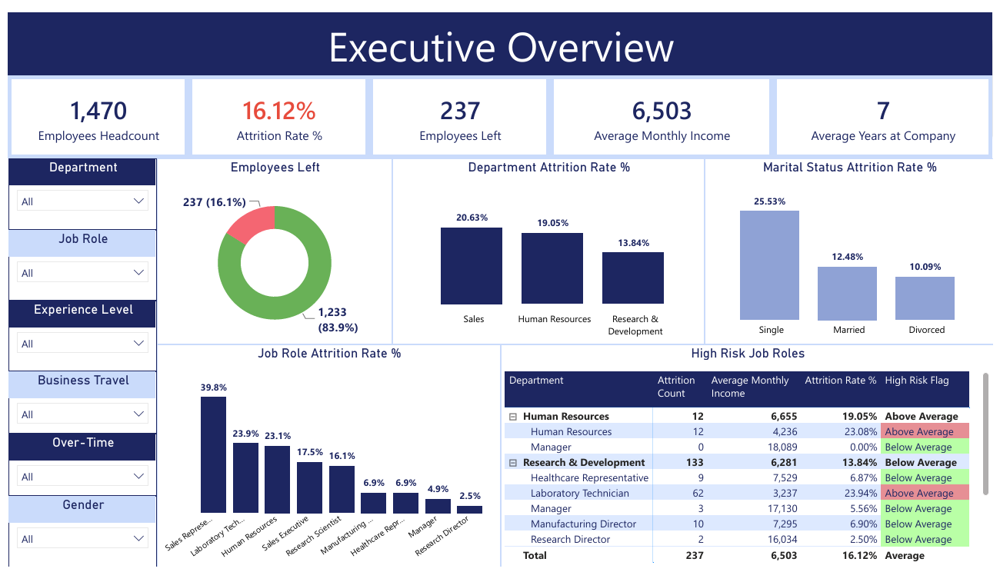
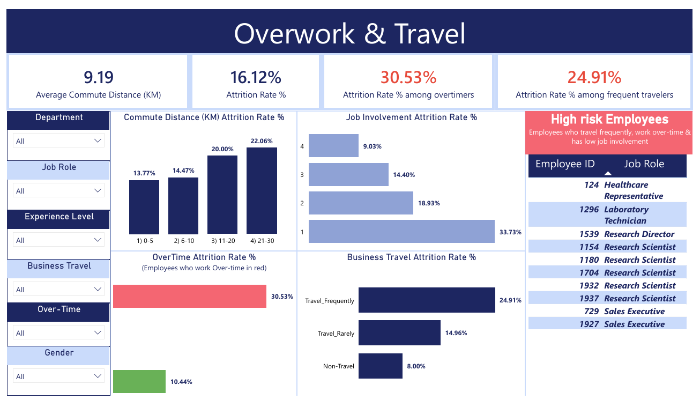
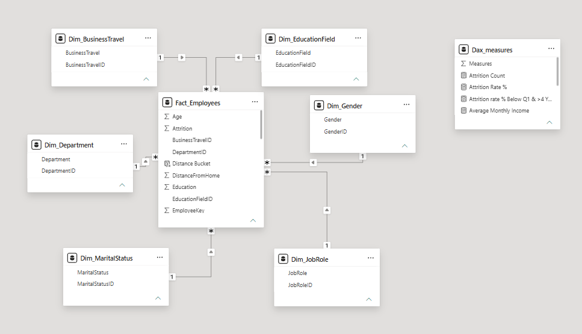

# Employee Attrition Analysis: Power BI Dashboard & Star Schema

**Where are we losing employees, why, and what should HR do first?**

| | |
|---|---|
| **Industry** | Human Resources / People Analytics |
| **Role** | BI Developer / Data Analyst |
| **Tools** | Power BI (DAX, Power Query), Python (pandas, SQLAlchemy), SQL Server, Excel |
| **Deliverables** | 5-page interactive dashboard (.pbix), star-schema data model, insights deck (PDF) |

---

## 1. The Business Problem (in plain words)

Leadership wanted to understand **employee attrition** in a company of 1,470 employees: **how many people leave, who they are, and what drives them out.** The goal was a dashboard that HR and executives can filter themselves, plus a short set of actions ranked by impact.

## 2. The Short Answer

**16.12% of employees left (237 of 1,470).** Attrition is not evenly spread. It concentrates in specific roles, in overworked and highly traveled staff, in the first two years of a role, and among employees with no stock options.

| Where it concentrates | Attrition rate | Company average |
|---|---|---|
| Sales Representatives | 39.8% | 16.1% |
| Employees working overtime | 30.5% (vs 10.4% without) | 16.1% |
| Frequent business travelers | 24.9% | 16.1% |
| Junior employees (under 5 years' experience) | 32.9% | 16.1% |
| Employees with zero stock options | 24.4% | 16.1% |

## 3. The Dashboard (5 pages)

1. **Executive Overview:** headline KPIs, attrition by department, job role and marital status, and a high-risk job roles table.
2. **Overwork & Travel:** overtime, business travel, job involvement, and commute distance, plus a list of high-risk employees (frequent travel + overtime + low job involvement).
3. **Experience Level:** attrition by experience band, time in role, and time with the current manager.
4. **Compensation & Equality:** stock options, pay vs tenure, and gender pay comparison.
5. **Satisfaction & Performance:** job, environment, relationship and work-life-balance ratings, and performance ratings.

Every page has filters for department, job role, experience level, business travel, overtime and gender, so each reader can look at their own segment.

## 4. Key Insights

- **Sales Representatives are the biggest outlier:** 39.8% leave, almost 2.5x the company average. Laboratory Technicians (23.9%) and HR staff (23.1%) follow.
- **Overwork is the strongest signal:** overtime nearly triples attrition (30.5% vs 10.4%). Among employees working overtime with the lowest work-life-balance rating, attrition reaches 45.5%.
- **The first two years are the riskiest:** attrition is 22.6% for people 0-2 years in their role and 28.3% for those 0-1 years with their current manager, dropping sharply after that.
- **Single employees leave more often** (25.5% vs 12.5% married and 10.1% divorced).
- **Equity matters:** employees with no stock options leave at 24.4%. 122 employees with 5+ years of tenure sit in the lowest pay band, and their attrition (18.9%) is above average.
- **No gender pay gap:** average income is nearly identical by gender at every experience level, so it was ruled out as a driver.
- **Performance ratings do not separate people:** about 85% of employees are rated exactly 3 and nobody is rated 1 or 2. The ratings have no relationship with attrition but strongly track salary hikes, so pay increases may not reflect real performance differences.

## 5. Recommendations

1. **Reduce overtime and travel load in high-risk roles.** Audit workload in Sales and cap travel frequency where possible.
2. **Formalize first-year and new-manager onboarding.** Add structured check-ins through the first 12 months.
3. **Expand stock option eligibility for junior staff.** Pilot equity at Job Level 1 in the highest-turnover roles.
4. **Revisit the performance rating scale** so managers get a usable signal and salary hikes reflect real differences.

## 6. Approach

1. **Prepared the data in Python:** loaded the source file (1,470 rows, 35 columns), trimmed text, converted Yes/No fields (attrition, overtime) to 1/0, and dropped columns with no analytical value (hourly/daily/monthly rate, employee count, over-18 flag, standard hours).
2. **Built a star schema:** one fact table (`Fact_Employees`) with six dimension tables (education field, business travel, department, gender, job role, marital status), created with a reusable function.

3. **Added experience levels:** Junior (under 5 years), Mid (5-9 years), Senior (10+ years), based on total working years.
4. **Loaded the model into SQL Server and exported it to Excel**, then connected Power BI to it.
5. **Shaped the data in Power Query** and wrote **DAX measures** (attrition rate, headcount, high-risk flags, group comparisons), then designed the 5-page dashboard.
6. **Wrote the insights deck** with findings and ranked recommendations.

## 7. Challenges

- **Many possible drivers, one clear story:** the data has 30+ fields, so the work was filtering down to the factors that actually separate leavers from stayers.
- **Small groups can mislead:** some job roles have very few leavers (for example 0% attrition among HR managers), so I flagged risk against the company average instead of reading too much into tiny segments.
- **Weak signal in performance ratings:** nearly everyone has the same rating, so it cannot explain attrition, which became a finding in itself.
- **Designing for two audiences:** executives need one clean overview page, while HR needs the detail to act, so the dashboard is layered from summary to detail.

## 8. Files

| File | What it is |
|---|---|
| [`database_creation.ipynb`](code/database_creation.ipynb) | Python data preparation and star-schema build |
| [`Employee_Attrition_Dashboard.pbix`](powerbi/Employee_Attrition_Dashboard.pbix) | Power BI file (data model, Power Query steps, DAX measures) |
| [`Employee_Attrition_Dashboard.pdf`](reports/Employee_Attrition_Dashboard.pdf) | Export of the 5-page Power BI dashboard |
| [`Employee_Attrition_Insights.pdf`](reports/Employee_Attrition_Insights.pdf) | Insights and recommendations deck |

## 9. What to Know Before Using This

- Findings show **association, not proof of cause.** For example, overtime goes with higher attrition, but the data cannot show that overtime alone causes people to leave.
- The dataset covers 1,470 employees in one snapshot, so trends over time can't be measured.
