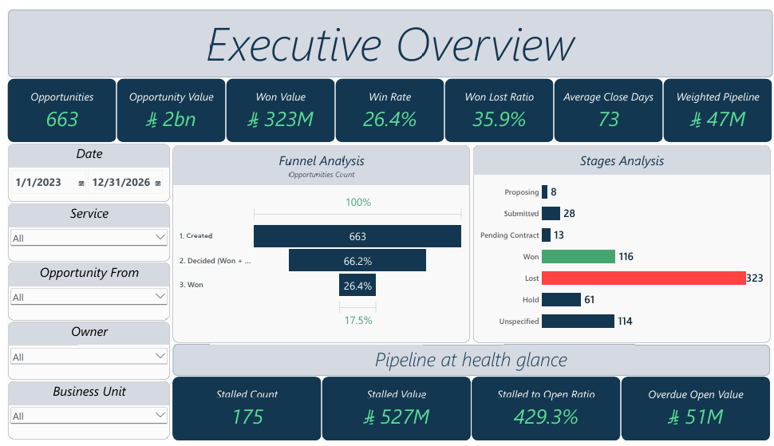
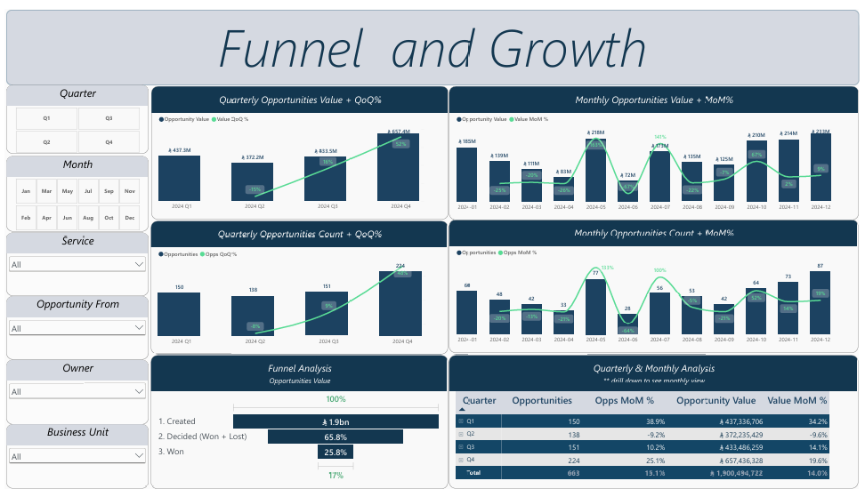

# Sales Pipeline Performance Analysis: Power BI Dashboard & Review

**The pipeline is growing, so why is only one in four decided deals won?**

| | |
|---|---|
| **Industry** | B2B Services / Sales Analytics |
| **Role** | BI Developer / Data Analyst |
| **Tools** | Power BI (DAX, Power Query) |
| **Deliverables** | 6-page interactive dashboard (.pbix), insights and recommendations deck (PDF) |

---

## 1. The Business Problem

A B2B services company tracked its sales opportunities in a CRM: 663 opportunities worth 1.90B in total. Leadership wanted to know **how healthy the pipeline really is, where deals are being lost, and what to change to win more.**

The deliverable was a dashboard sales leaders can filter by service, lead source, owner, and business unit, plus a short review with ranked recommendations.

## 2. The Short Answer

**Volume is growing, but conversion is weak.** Only **26.4%** of decided deals are won (116 won vs 323 lost), and a large part of the pipeline sits in limbo with no clear status.

| Signal | What the data shows |
|---|---|
| Growth | Q4 opportunities rose 48% over Q3 (value +52%), driven by volume, not bigger deals |
| Conversion | 26.4% win rate; 0.36 deals won for every deal lost |
| Pipeline health | 175 deals sit on Hold or Unspecified, worth 527M, which is 4.3x the 123M of live pipeline |
| Overdue | 23 live opportunities (51M) are already past their expected close date |
| Sales team | Five owners holding 40% of the pipeline win 11.5% of decided deals vs 36.2% for the other six |

## 3. The Dashboard (6 pages)

1. **Executive Overview:** headline KPIs (opportunities, value, win rate, average days to close, weighted pipeline) and a funnel from created to decided to won, plus pipeline-health indicators.
2. **Funnel and Growth:** quarterly and monthly opportunity count and value with growth rates, and a drillable quarter-to-month table.
3. **Forecast:** open and weighted pipeline by expected closing date and stage probability, stalled pipeline by owner, and a table of overdue deals.
4. **Sales Team Performance:** won value, closing time, win rate vs volume, and the won/lost/stalled mix per owner.
5. **Services:** demand by service and business unit, and a service-by-owner heatmap.
6. **Customers:** new vs repeat customers, top accounts, lead sources, and accounts pursued repeatedly with no wins.

Every page has filters for date, service, lead source, owner, and business unit.

## 4. Key Insights

- **Growth comes from volume.** Quarterly opportunities went 150 → 138 → 151 → 224 in 2024. The average deal stays steady at about 2.9M, so growth is not a result of bigger deals.
- **The pipeline is full of undecided deals.** 175 opportunities (about 27% of the total) are on Hold or have no stage. Because these carry no probability in the forecast, the real pipeline is harder to read than the headline numbers suggest.
- **Win rate varies widely by service.** Digital Quality Assurance wins about 47% of decided deals, while Consultation & Advisory (the second-largest source of demand at 279M) wins 14.7%. Application Security and Cloud services are around 15%.
- **There is a performance gap between owners.** Win rates range from about 8% to 41%. One owner accounts for 28% of opportunities and 40% of won value.
- **Repeat customers convert twice as well:** 30.7% vs 15.4% for new customers. Yet 57% of customers have only ever had one opportunity.
- **Some accounts absorb effort without results.** 29 of the 66 customers with 3 or more opportunities have never been won, and one business unit has won 0 of 10 decided deals.

## 5. Recommendations

1. **Clear the undecided deals.** Force a Won, Lost, or dated next step on the 175 Hold and Unspecified deals, re-date the 23 overdue ones, and make Stage a required field in the CRM.
2. **Close the owner gap.** Pair low win-rate owners with top performers in weekly deal reviews and share the top performer's approach. Reaching the 26% average would mean about 26 more wins, roughly 72M (illustrative).
3. **Focus on services that convert.** Lead with the services that win most often, and qualify harder or rework the ones that win about 15% of the time.
4. **Target and expand accounts.** Grow existing customers, and add a go/no-go review after 3 losses with no win on an account.

## 6. Approach

1. **Prepared the data in Power Query:** cleaned the CRM opportunity export, counted each opportunity once per ID, and assigned quarters and months from the opportunity date.
2. **Defined the metrics:** win rate = won ÷ (won + lost), so undecided deals don't distort it. "Stalled" means Hold or Unspecified. "Overdue" means a live deal past its expected close date.
3. **Built the forecast:** weighted each open deal by its stage probability and placed it by expected closing date. Hold and Unspecified carry 0%.
4. **Wrote DAX measures** for win rate, won/lost ratio, average days to close, stalled and overdue values, growth rates (quarter and month), and owner ranking.
5. **Designed six dashboard pages** that move from a summary view to detail for owners, services, and customers.
6. **Wrote the review deck** with findings, gaps, and ranked recommendations.

## 7. Challenges

- **Undecided deals distort the picture.** Over a quarter of opportunities had no outcome. I measured win rate on decided deals only and showed the stalled pipeline as its own issue.
- **Forecasting with imperfect dates and stages.** Some deals were already past their expected close date, and deals without a stage can't be given a probability. I flagged them instead of guessing.
- **Small samples.** Several owners and business units have few deals, so I treated those results as indicative and not conclusive.
- **A snapshot assumption.** The review treats the last opportunity date in the data as "today", which affects the overdue and stalled counts.

## 8. Files

| File | What it is |
|---|---|
| [`Sales_Pipeline_Dashboard.pbix`](powerbi/Sales_Pipeline_Dashboard.pbix) | Power BI file (data model, Power Query steps, DAX measures) |
| [`Sales_Pipeline_Dashboard.pdf`](reports/Sales_Pipeline_Dashboard.pdf) | Export of the 6-page dashboard |
| [`Sales_Pipeline_Review.pdf`](reports/Sales_Pipeline_Review.pdf) | Insights and recommendations deck |

## 9. What to Know Before Using This

- The impact estimates (for example, "26 more wins") are illustrative, not forecasts.
- Owner and business-unit comparisons rest on small samples, so read them as directional.
- The source data file is not published, so only the dashboard file and reports are included.
