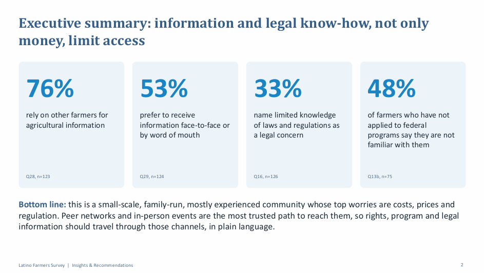
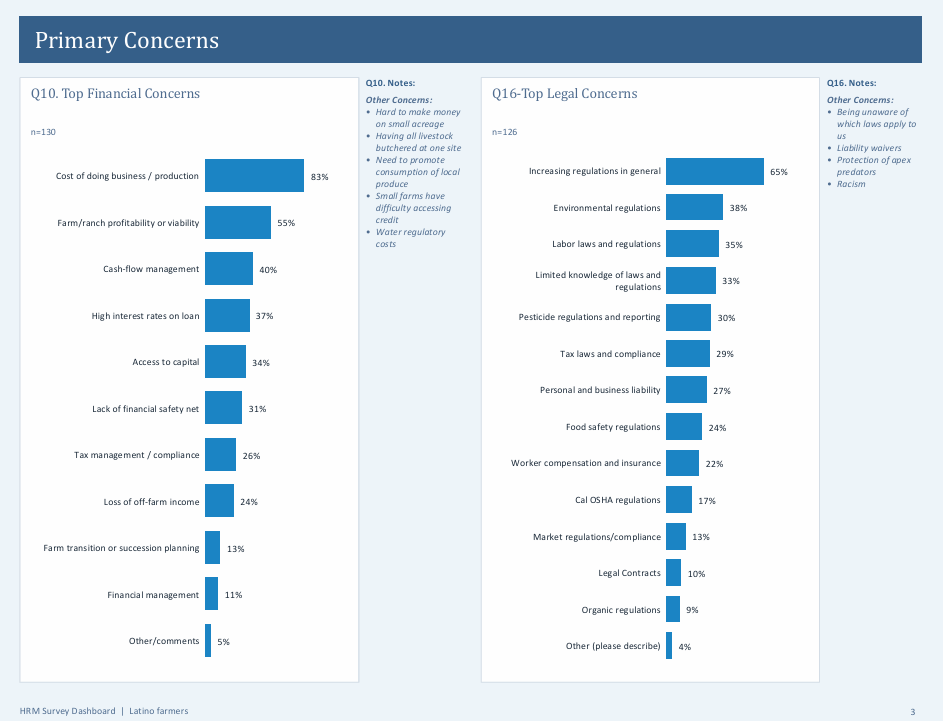

# Farmer Survey Analysis: Results Dashboard, Insights & Recommendations

**What worries Latino farmers most, what stops them from getting help, and how do we reach them?**

| | |
|---|---|
| **Industry** | Agriculture / Community Support Programs |
| **Role** | Data Analyst |
| **Tools** | Google Sheets (analysis and dashboard), PowerPoint (insights deck) |
| **Deliverables** | 18-page survey results dashboard, 22-page insights and recommendations deck (both PDF) |
| **Data & Privacy** | All figures are illustrative sample data, and names and logos are removed. No raw data is published. |

---

## 1. The Business Problem

A survey of about 130 Latino farmers and ranchers across the U.S. (most responses came from California) asked about their farms, finances, legal worries, insurance, and how they get information. A support program wanted to understand **what holds these farmers back and how to reach them with information about their rights and the programs open to them.**

The work had two parts: a dashboard that shows every survey question clearly, and a short insights deck that turns the results into recommendations.

## 2. The Short Answer

**Money worries come first, but the bigger barrier is information.** Most farmers are small, family-run operations that depend on each other for advice and aren't reached by official channels.

| Finding | Result |
|---|---|
| Rely on other farmers for agricultural information | 76% |
| Prefer to get information face-to-face or by word of mouth | 53% |
| Name limited knowledge of laws and regulations as a legal concern | 33% |
| Non-applicants to federal programs who say they aren't familiar with them | 48% |
| Have applied to at least one federal program | 42% |

## 3. The Dashboard

The 18-page dashboard covers the full survey in nine sections: primary concerns, how to address those concerns, financial tools and practices, insurance, information needs, farm characteristics, farm economics, farming background, and demographics.

Every chart shows its question number and sample size (n), so readers can see how many people answered and trace each result back to the survey.

## 4. Key Insights

- **Costs and prices top every list of concerns.** Cost of doing business is the leading financial worry (83%), sales prices the leading market worry (80%), and water (64%) and labor (52%) lead production worries.
- **Regulation is the biggest legal worry.** 65% cite increasing regulation, and a third say they don't know which laws apply to them.
- **Farmers ask for fair rules and credit, not training.** "Supportive regulations" is rated most important by 40-42% across production, market, and financial concerns, access to credit by 33-38%, and more skilled staff by only 10-12%.
- **Federal programs and crop insurance are under-used because of awareness.** 48% of non-applicants don't know the federal programs, and 34% of farmers without crop insurance never heard of it. Price is a smaller reason (25%).
- **Reported profit is likely overstated.** 72% say the farm is profitable in at least some years, but 67% don't count pay for their own time, and 62% rely on off-farm income.
- **Land tenure is fragile.** 40% of renters pay cash rent with no written lease.
- **Reaching them takes people, not just paper.** After other farmers (76%), pest control advisors reach 41%, while county agriculture departments (33%) and university extension (27%) reach fewer. Face-to-face is preferred (53%), with websites (47%) and text/WhatsApp (31%) behind.
- **The community is experienced and small-scale.** 66% are 46 or older, 61% farm 50 acres or fewer, 43% sell under 50,000 a year, and 44% were born outside the U.S.

## 5. Recommendations

1. **Build a peer-ambassador network.** Train respected growers to share rights and program information.
2. **Lead in person, back it up with messaging.** Pair field days with a text/WhatsApp group.
3. **Add program and insurance navigators** who give hands-on help in Spanish.
4. **Publish a know-your-rights toolkit** covering labor, safety, and complaint channels.
5. **Secure land tenure and credit** with lease templates and credit guidance.
6. **Reach under-served groups and places** with regional, bilingual events, since 12 of 34 counties have only one respondent.

**Proposed targets for the next survey:** applied to at least one federal program from 42% to 55%, renters with no written lease from 40% to 25%, and limited legal knowledge from 33% to 20%.

## 6. Approach

1. **Summarized every survey question in Google Sheets** with its question number and sample size, grouping them into themes: concerns, needs, finances, insurance, information, farm profile, and demographics.
2. **Created derived variables** to answer deeper questions: any organic or ecological practice, farms using only family or friends as labor, intermediate-market-only sellers, and crop-type diversity.
3. **Looked for gaps** between what farmers use, what they know, and what they need, such as program use against awareness.
4. **Wrote a "so what" for every finding** so each result leads to an action.
5. **Built the dashboard in Google Sheets and the insights deck in PowerPoint**, and added a page on how to read the results with their limits.

## 7. Challenges

- **Very different sample sizes.** Questions have between 16 and 133 responses, so small follow-up questions are treated as directional only.
- **Multi-select questions.** Many answers add up to more than 100%, so results are shown as the share of respondents who chose each option.
- **A self-selected sample.** Respondents chose to take part, so results describe this group and not all Latino farmers. The deck says so.
- **Open-ended answers.** Write-in responses held useful detail (for example, labor shortages and unawareness of which laws apply), so they sit beside the numbers instead of being dropped.
- **Missing links.** The discrimination questions still need to be cross-tabbed by language, age, farm size, and region, and the deck lists this as a next step.

## 8. Files

| File | What it is |
|---|---|
| [`Survey_Results_Dashboard.pdf`](reports/Survey_Results_Dashboard.pdf) | 18-page dashboard of all survey results |
| [`Survey_Insights_and_Recommendations.pdf`](reports/Survey_Insights_and_Recommendations.pdf) | Insights and recommendations deck |

## 9. What to Know Before Using This

- All figures are illustrative sample data. The project shows the analysis method and the way findings turn into recommendations.
- Results show **associations, not causes.** For example, relying on peers doesn't prove that information gaps cause worse outcomes.
- The sample is self-selected, so it should not be read as representing all farmers.
