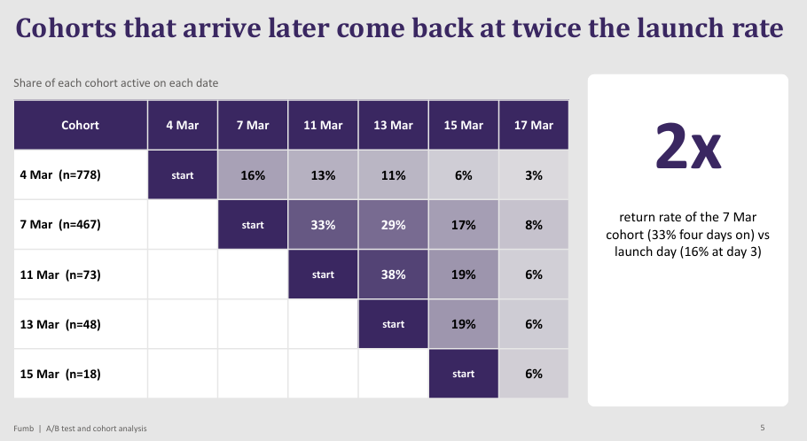
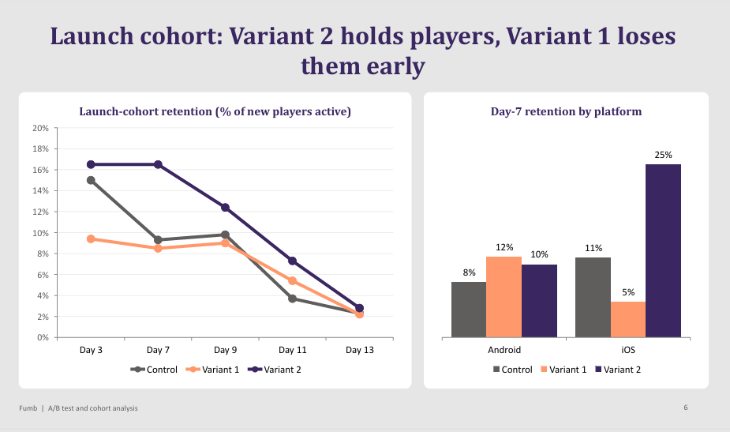

# Mobile Game A/B Test & Cohort Analysis: KPIs, Retention and Monetization

**Which version of the game keeps players and earns money, and what should the team do next?**

| | |
|---|---|
| **Industry** | Mobile Gaming / Product Analytics |
| **Role** | Product / Data Analyst |
| **Tools** | Python (pandas, NumPy, matplotlib, seaborn, SQLAlchemy), SQL, Power BI (DAX, Power Query), PowerPoint |
| **Deliverables** | Analysis notebook, KPI overview deck, A/B test and cohort deep-dive deck (PDF) |
| **Data & Privacy** | Data is not confidential. The notebook and reports are included; the raw event data is not published. |

---

## 1. The Business Problem

Soon after launch, a mobile game ran a **multivariate A/B test** with a control version and two variants. Revenue came from in-app purchases and from ads. The team needed to know:

- How is the game performing day to day (players, revenue, retention)?
- Did either variant win?
- What should be fixed first?

The work is split into two decks on the same data: a **KPI overview** that sets out the metrics, and a **deep dive** into cohorts, ad behavior, and each variant.

## 2. The Short Answer

**Neither variant wins outright. Variant 1 earns more from purchases, Variant 2 keeps more players, and the biggest problem is that most players leave within days.**

| Signal | What the data shows |
|---|---|
| Revenue mix | About three-quarters of revenue comes from ads, so revenue follows the number of active players |
| Who pays | Only 1.4% of players ever purchase, and 29% of revenue comes from the top 1% of players |
| Retention | 13.6% of new players are back by day 3; after the launch burst, the player base shrinks quickly |
| Variant 1 | Best purchase revenue (+70% per active player) but the weakest early retention (-37% at day 3) |
| Variant 2 | Best retention (+77% at day 7) but ads that earn 26% less each, so revenue per new player ends level with control |

## 3. KPI Overview

The overview deck defines and tracks the standard mobile-game metrics:

- **DNU / DAU:** new and daily active users
- **Paying users, ARPDAU, ARPPU:** revenue per active user and per paying user
- **Retention, churn, lifetime, and LTV:** how long players stay and what they are worth

It shows a sharp launch spike followed by a lower steady level, revenue that rises and falls with the player count, and paying-user numbers so small that ARPPU swings from day to day. Retention and LTV are estimated from only the last 8 days of the test, so the deck marks them as indicative.

## 4. Key Insights

- **Launch day carries the business, then it fades fast.** Daily active players and revenue drop sharply after launch week.
- **A thin tail earns most of the money.** The top 1% of players generate 29% of revenue, the top 10% generate 73%, and 40% of players generate nothing. 99.5% of ad revenue comes from US players.
- **Later cohorts come back at about twice the launch rate.** About a third of players who arrived a few days after launch were still active four days later, versus 16% of launch-day players.
- **Variant 2 sells more ads at a lower price.** It shows 33% more ads per player, but each ad is worth 26% less, so ad revenue per player is only 2% higher.
- **Ad value falls through the day.** The first ad of the day is worth far more than the later ones, so more ads does not mean more money.
- **Day-0 behavior predicts return.** Players who complete a mission return 30% of the time vs 13%. Three or more sessions on day 0 gives 48% vs 16%, and watching 10+ ads gives 52%.
- **Variant 1 buyers spend more per payer** (about $15 vs $9), while Variant 2 holds players better.

## 5. Recommendations

1. **Fix Variant 2's ad delivery.** Matching the control's value per ad would lift its ad revenue by about a third.
2. **Cap daily ads and favor rewarded ads,** since ad value drops steeply across the day.
3. **Win day 0.** A first mission and a second session lift return rates 2-3x.
4. **Blend the variants.** Variant 1 monetizes buyers, Variant 2 keeps players.
5. **Focus acquisition on the US,** which earns far more per player-day than the rest of the world.
6. **Re-test at scale.** About 5,500 players per group are needed to read a purchase lift reliably.

**Action plan:** weeks 1-2 diagnose (audit Variant 2's ad setup, log first-open and daily events); weeks 3-4 build (day-0 mission and second-session flow, daily ad cap); month 2 re-test with three groups, shipping if day-7 retention rises 3 points and revenue per active user holds.

## 6. Approach

1. **Prepared the event data with Python and SQL** (Python connected to SQL through SQLAlchemy), and cleaned it in Python: removed duplicate rows, dropped the one row missing a session number, and converted timestamps and dates.
2. **Identified new players** from each user's first active date, since there was no separate install event.
3. **Built the KPIs** in Python and Power BI (DAX measures, Power Query steps): DNU, DAU, revenue (in-app purchases plus ad revenue), ARPDAU, ARPPU, paying users, retention, churn, lifetime, and LTV.
4. **Split the test period into two windows** and measured retention and lifetime value on the second.
5. **Compared the control with both variants** on retention, revenue per player, ad volume, and value per ad.
6. **Built cohort retention tables** to see how players who arrived on different days behave.
7. **Wrote two decks:** a KPI overview and a deep dive with recommendations and an action plan.

## 7. Challenges

- **A very short window.** Retention and lifetime estimates come from days of data, whereas games usually need 28-90 days, so I labeled them indicative.
- **Very few paying users.** Only 1.4% of players purchase, so purchase differences between variants can be random noise. That is why the deck asks for a larger re-test.
- **No install event.** New players had to be inferred from their first activity.
- **Mixed signals between variants.** Each variant wins on a different metric, so the answer is a trade-off and not a single winner.

## 8. Files

| File | What it is |
|---|---|
| [`ab_test_kpi_analysis.ipynb`](code/ab_test_kpi_analysis.ipynb) | Python data cleaning and KPI calculations |
| [`KPI_Overview.pdf`](reports/KPI_Overview.pdf) | KPI definitions and trends |
| [`AB_Test_and_Cohort_Analysis.pdf`](reports/AB_Test_and_Cohort_Analysis.pdf) | Deeper insights, recommendations, and action plan |

## 9. What to Know Before Using This

- Retention, lifetime, and LTV figures are estimates from a short window and are indicative only.
- Variant differences in purchases rest on very few paying users, so treat them as directional until the re-test.
- The raw event data is not published, so the notebook is shown for reference and can't be re-run as is.
- The SQL scripts and the Power BI file used in this project are not included in this repo.
