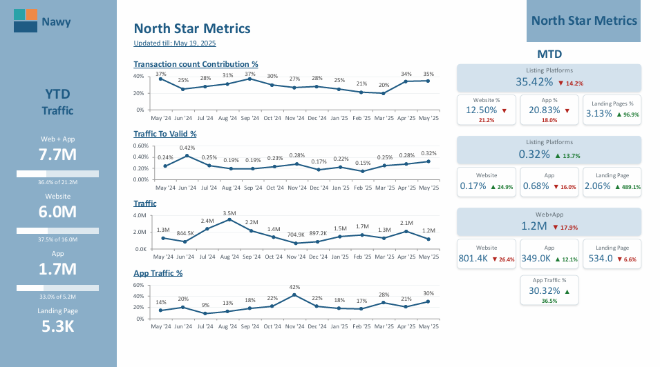
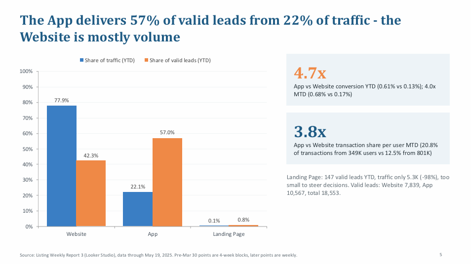

# Real Estate Listing Channel Performance: Funnel, Traffic & Lead Quality

**Is the property-listing channel still pulling its weight, and where is it leaking quality?**

| | |
|---|---|
| **Industry** | Real Estate / PropTech |
| **Role** | Senior Data Analyst |
| **Tools** | Looker Studio, SQL, Google Analytics 4 (GA4), Mixpanel, PowerPoint |
| **Deliverables** | Weekly performance dashboard (29-page PDF), analysis, insights and recommendations deck (13-page PDF) |
| **Data & Privacy** | The data is private. All figures in these files are masked or replaced with sample data. The live Looker Studio dashboard is not shared, so a PDF version is included. |

---

## 1. The Business Problem

A real estate company sells property through several routes. One of them is its **property-listing platforms**: a website, a mobile app, and landing pages where people browse listings and leave their details. The team tracked this channel in a weekly dashboard and wanted to know **how it contributes to sales, where its traffic and leads come from, and whether lead quality is holding up.**

The work covers a weekly dashboard of "North Star" metrics and a deeper analysis with ranked recommendations.

## 2. The Short Answer

**Listing is a high-quality channel, but its share of sales is slipping and the app funnel is getting noisier.**

| Signal | What the data shows |
|---|---|
| Share of sales | Listing platforms produced 25% of transactions year to date (down 6.9% on the prior period); volume grew 2.2% while the company overall grew 9.8% |
| App vs website | The app brings 57% of valid leads from only 22% of traffic and converts 4.7x better than the website (0.61% vs 0.13%) |
| Website traffic | Traffic fell 50% since July while valid leads rose 11%, so more visits did not mean more leads |
| App lead quality | App valid leads grew 142% since January, but the share qualified after one week fell from 54% to 30% |

## 3. The Dashboard

The 29-page PDF version of the dashboard is organized in six sections:

1. **North Star Metrics:** transactions, traffic, traffic-to-valid-lead rate, and app share of traffic, each shown month-to-date and year-to-date against the previous period.
2. **Sales Contribution:** listing vs company transactions, with and without personal, ambassador and referral deals, and the split by website, app and landing page.
3. **Traffic:** users by platform, paid vs unpaid, by campaign, new vs returning, and the app's move to a new "super app".
4. **Users:** app downloads versus deletions on iOS and Android.
5. **Conversion:** traffic to valid lead for the listing platforms overall, the website, and the app.
6. **Leads:** valid and qualified lead breakdowns by channel.

## 4. Key Insights

- **Volume is up, but share is down.** Listing transactions grew slower than the company's total, so its share fell to 25%. Even so, in 14 of 21 periods it delivered 50% or more of transactions once personal, ambassador and referral deals were excluded, which makes it the main non-relationship channel.
- **The app is the engine and the website is the megaphone.** The website brings 78% of traffic but 42% of valid leads, and its valid leads stay near 500 per period whether traffic is 330K or 650K.
- **Website traffic is mostly paid and low intent.** 88% of website users on one sample day were paid, and the highest-volume days had the lowest lead rates.
- **App lead quality is the biggest risk.** Leads more than doubled, while qualification fell from 54% to 30%, meetings from 6.4% to 4.1%, and four-week contraction by 72%.
- **The super-app launch looks like migration, not growth.** Total active users stayed flat to down after launch while the old app lost users at the same pace the new one gained them. With only 8-10 days of data, the deck marks this as a hypothesis.
- **Android holds the install base but loses it.** Android deleted 70% of May acquisitions compared with 16% on iOS.
- **Listing leads are worth more.** They reach meetings 1.7x as often as other leads (4.3% vs 2.5%) and qualify slightly better.

## 5. Recommendations

| # | Action | Priority |
|---|---|---|
| 1 | Audit the app's "valid lead" definition and add a qualification gate | High |
| 2 | Cap the broad paid campaign volume on the website and shift budget to high-intent audiences | High |
| 3 | Report the old and new app together, and track listing journeys inside the new app | High 
| 4 | Investigate Android churn and compare lead quality by operating system | Medium |
| 5 | Set a follow-up standard for listing leads and rebuild listing share through the app | Medium |

**Action plan:** in the next 2 weeks, agree one conversion definition; in 30-60 days, test the campaign cap and audit app lead quality; next quarter, run an Android retention program and a cohort view from valid lead to contraction.

**Weekly KPIs to track:** listing share of transactions, valid leads per 1,000 visits, qualification and contraction by channel (matured cohorts only), combined app active users, and the Android deletion ratio.

## 6. Approach

1. **Defined the North Star metrics** for the channel: listing share of transactions, traffic, traffic-to-valid-lead rate, and app share of traffic.
2. **Pulled and combined the data** using SQL for transactions and leads, and GA4 and Mixpanel for web and app traffic and behavior.
3. **Built the Looker Studio dashboard** with month-to-date and year-to-date comparisons against the previous period.
4. **Used cohorts for lead quality,** following leads one week (qualification, meetings) and four weeks (contraction) after they arrived, and only reading matured cohorts.
5. **Compared channels and platforms:** website vs app vs landing page, paid vs unpaid, iOS vs Android.
6. **Audited the report itself** for broken pages, conflicting definitions, and unreliable small samples.
7. **Wrote the insights deck** with evidence, a metric to watch, and a priority for each action.

## 7. Challenges

- **Conflicting numbers.** The same metric appeared with different values on different pages because of different traffic and period definitions, so I traced each one and recommended a single definition.
- **Cohorts that haven't finished maturing.** Recent weeks showed 0% for four-week outcomes, so I excluded them from trend reads.
- **Tiny samples.** Landing-page percentages swung wildly on a few hundred visits, so I treated them as noise.
- **A moving target.** A new super app launched while I was analyzing, so the old and new app had to be read together.

## 8. Files

| File | What it is |
|---|---|
| [`Listing_Dashboard.pdf`](reports/Listing_Dashboard.pdf) | 29-page PDF of the Looker Studio dashboard |
| [`Listing_Analysis_Insights_Recommendations.pdf`](reports/Listing_Analysis_Insights_Recommendations.pdf) | Analysis, insights, and recommendations deck |

## 9. What to Know Before Using This

- All figures are masked or sample data. The project shows the method and the thinking, and the numbers are not real results.
- The live Looker Studio dashboard and the SQL, GA4, and Mixpanel queries are not included.
- Several findings (such as the super-app migration) come from a short window and are hypotheses to confirm.
