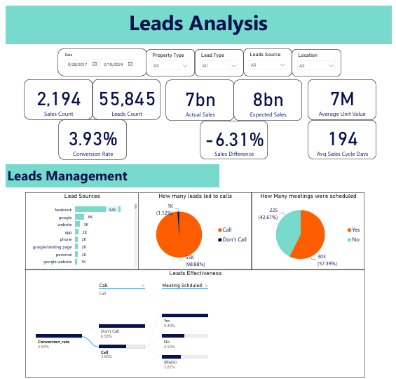
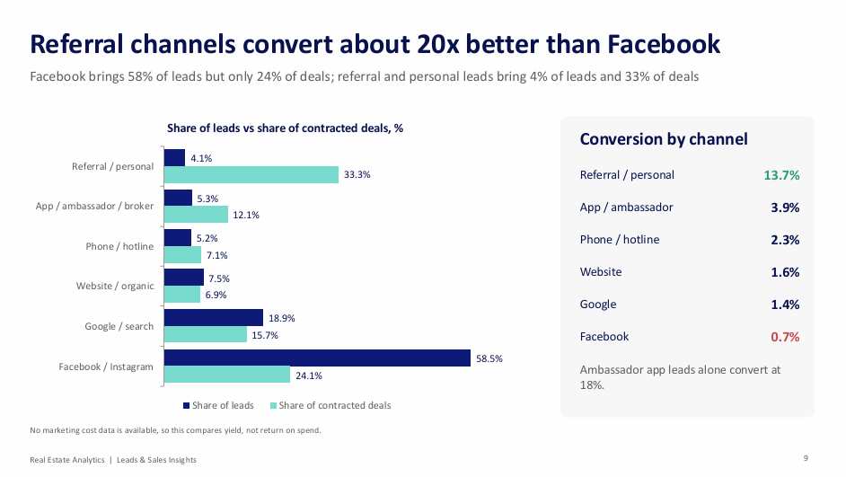

# Real Estate Leads & Sales Analysis: Where Leads Turn into Sales

**Demand is not the problem. Which leads actually become sales, and what is it worth fixing first?**

| | |
|---|---|
| **Industry** | Real Estate / Sales Analytics |
| **Role** | Senior Data Analyst |
| **Tools** | Power BI (DAX, Power Query), SQL, PowerPoint |
| **Deliverables** | 3-page interactive dashboard (PDF), 20-page insights and recommendations deck (PDF) |
| **Data & Privacy** | The data is private. All names and figures in these files are masked or replaced with sample data. The Power BI file and queries are not included. |

---

## 1. The Business Problem

A real estate company had collected **55,845 sales leads and 2,194 sale records over more than six years** (September 2017 to February 2024). Leads were growing fast, but sales were not keeping pace. Leadership wanted to know **which lead sources, locations, property types, and sales agents turn leads into signed contracts, how long it takes, and how much money is waiting in the pipeline.**

The work has two parts: a dashboard for exploring leads and sales, and an insights deck with a ranked action plan.

## 2. The Short Answer

**Leads are plentiful but their yield is weakening, and the channels that bring the most leads bring the worst ones.**

| Signal | What the data shows |
|---|---|
| Lead-to-contract rate | 1.7% of unique leads reached a signed contract (940 of 55,845) |
| Lead growth vs yield | Leads doubled in 2023 (29.2K vs 14.2K), but the share contracted within 90 days fell about a third |
| Channel quality | Referral, personal, and ambassador leads convert at 13.7% vs 0.7% for Facebook, and close 2.4x faster |
| Unworked leads | 9,925 leads are still waiting for a first contact, and over half of all leads never reach a real conversation |
| Money waiting | About 6.1B is open in the pipeline, including 189 reserved units worth 1.45B not yet contracted |

## 3. The Dashboard (3 pages)

1. **Overview:** sales count, leads count, conversion rate, average sales cycle, actual vs expected sales, and the top lead sources and property types.
2. **Leads Analysis:** where leads come from, how many led to calls and meetings, and conversion by lead type and lead source.
3. **Sales Analysis:** sales by property type and location, achievement against target, and sales cycle by source and property type.

Every page can be filtered by date, property type, lead type, lead source, and location.

## 4. Key Insights

- **Lead volume doubled, yield did not.** Quarterly leads grew from about 2K to about 9.5K, and 58% now come from Facebook and Instagram, the lowest-yield channel.
- **97.8% of leakage happens before a sale record exists.** Once a unit is reserved, it closes quickly (a median of 9 days to contract), versus 31 days from lead to reservation.
- **Over half of leads never get a real conversation.** 26% are unreachable, 18% are still waiting for a first call, and 14% are junk or unqualified. 846 recruitment leads sit in the sales pool and none converted.
- **Referrals are worth about 20x more than Facebook.** Referral and personal leads are 4% of leads but 33% of deals. Facebook is 58% of leads but 24% of deals.
- **Speed depends on the source.** Half of contracts close within 53 days, but ambassador and personal leads close in about a month, Facebook in 83 days, and phone leads in 213.
- **The money is concentrated in a few regions.** The largest confirmed value comes from New Cairo, North Coast, and 6th of October City. North Coast takes 119 days to close, over 4x as long as New Capital (28).
- **Apartments carry volume, villas and retail carry ticket size.** A villa deal is about 3.7x the size of an apartment deal.
- **Sales are accelerating.** Q4 2023 delivered 328 contracts, nearly 3x the same quarter a year earlier.
- **Expected deal values are reliable.** Three out of four deals land within 10% of the expected value.
- **Performance is spread across agents,** but five user IDs hold 25% of all assigned leads, and the biggest queues convert worst.

## 5. Recommendations

1. **Fix the Facebook funnel:** add budget and timing questions to forms and reply within minutes on WhatsApp. Lifting yield from 0.7% to 1.0% is worth about 98 more contracts on today's lead base.
2. **Scale referral and ambassador programs:** 1,000 referral-type leads would historically give about 137 contracts vs 7 from Facebook.
3. **Clear and protect the lead queue:** work or retire the 9,925 waiting leads, remove recruitment leads, and set a first-contact standard.
4. **Rebalance agent workloads:** cap queues and spread leads to agents who convert above average.
5. **Recover reserved units:** review the 189 reserved units weekly, newest first, with a clear owner.
6. **Make data capture mandatory:** budget, location, property type, actual value, and sold status should be recorded when the lead or deal is entered.

**90-day plan:** days 0-30 quick wins on the queue and reservations; days 31-60 rebuild the funnel; days 61-90 lock it in with required fields and capacity planning for the Q4 peak.

**KPIs to track:** 90-day conversion (1.0% today, aiming for 1.5%), first contact within an hour, referral share of leads (4% to 8%), reserved-to-contract rate, and budget captured (0.7% to 80%). Impact figures are indicative, based on historical conversion rates.

## 6. Data Gaps Found

The analysis also documents seven data-capture problems that limit what can be measured: duplicate lead rows, 40+ spellings of lead source, blank locations, budget filled on only 0.7% of leads, actual deal value missing on 40% of contracts, missing property type on 28% of sale records, and 36% of contracted leads not marked as sold.

## 7. Approach

1. **Cleaned the data:** removed 79 duplicate lead rows and standardized messy fields such as lead source.
2. **Defined clear terms first,** because the data has several ways to say "sale": a sale record, a reserved unit, a contracted (closed) deal, and a value-confirmed deal. Conversion and time to sale use contracted deals, and money figures use value-confirmed deals.
3. **Modeled the data in Power BI** with Power Query for preparation and DAX for the measures, with SQL used to extract and shape the data.
4. **Measured conversion with cohorts,** counting only leads with a full 90-day window so recent leads were not penalized.
5. **Compared segments:** lead source, lead type, location, region, property type, and agent.
6. **Sized the pipeline,** valuing reserved units at unit value and other open deals at expected value.
7. **Wrote the insights deck** with a recommendation, an owner-ready action, and a metric to watch for each finding.

## 8. Challenges

- **Several meanings of "sale".** Reserved, contracted, and value-confirmed deals give different counts, so I set definitions before any analysis.
- **Missing values.** Actual deal value was missing on 40% of contracts and budget on 99% of leads, so some comparisons are directional.
- **Immature recent data.** The data ended in February 2024, so the last quarter is partial and recent leads were still maturing. I used 90-day cohorts to stay fair.
- **No marketing cost data.** I could compare yield by channel but not return on spend, and the deck says so.
- **Currency not stated.** Values are assumed to be in Egyptian pounds.

## 9. Files

| File | What it is |
|---|---|
| [`Leads_and_Sales_Dashboard.pdf`](reports/Leads_and_Sales_Dashboard.pdf) | 3-page PDF of the Power BI dashboard |
| [`Real_Estate_Analytics_Insights.pdf`](reports/Real_Estate_Analytics_Insights.pdf) | Insights, recommendations, and 90-day plan |

## 10. What to Know Before Using This

- All figures are masked or sample data. The project shows the method and the thinking, and the numbers are not real results.
- The Power BI file and the SQL queries are not included in this repo.
- Impact estimates, such as extra contracts from a better funnel, are indicative and based on historical conversion rates.
