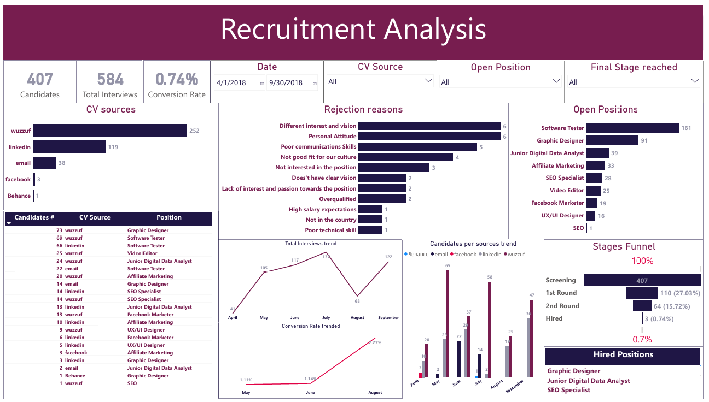
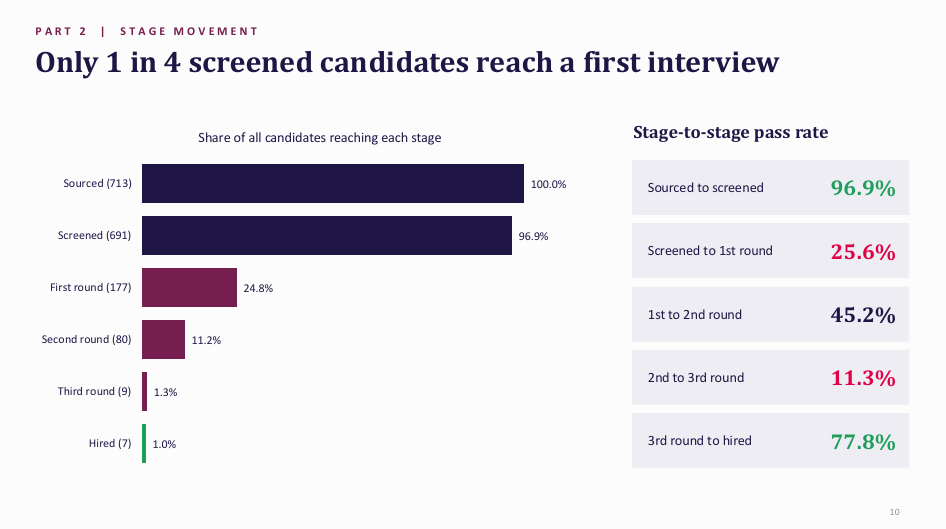

# Recruitment Funnel Analysis: Sourcing, Screening and Hiring Performance

**Strong sourcing, thin conversion: where do candidates drop out, and how do we hire faster?**

| | |
|---|---|
| **Industry** | Human Resources / Talent Acquisition |
| **Role** | Senior Data Analyst |
| **Tools** | Power BI (DAX, Power Query), SQL, PowerPoint |
| **Deliverables** | Recruitment dashboard (.pbix and PDF), performance review deck with recommendations (PDF) |
| **Data & Privacy** | The data is not confidential. The Power BI file is included; the source data file is not published separately. |

---

## 1. The Business Problem

A company hiring for roles in design, marketing, analytics, and testing received hundreds of CVs from several channels, but only a handful of people were being hired. The recruiting team had no clear view of **where candidates drop out, which sources and roles produce hires, and why people are rejected.**

The work has two parts: a dashboard that tracks the recruitment funnel, and a review of the full period with recommendations and a better data model.

## 2. The Short Answer

**Sourcing is strong, but only 1% of candidates are hired, and most are lost at screening.** In the review period (March 2018 to January 2019), 713 candidates led to 7 hires.

| Signal | What the data shows |
|---|---|
| Hire rate | 1.0% of candidates were hired (7 of 713), with a median of 19 days from CV to hire |
| Screening | 72% of candidates stop at screening, and only 1 in 4 screened candidates reaches a first interview |
| Sources | Wuzzuf supplies 60% of CVs, but LinkedIn converts to a first interview just as well, and gave 2 of the 7 hires |
| Rejection reasons | 93% of 567 rejections have no reason recorded |
| Screening consistency | Recruiters pass 14% to 35% of candidates, depending on who screens |

## 3. The Dashboard

The Power BI dashboard brings the recruitment funnel onto one page:

- **KPIs:** candidates, interviews, and conversion rate
- **Stages funnel:** screening, first round, second round, and hired
- **Trends:** interviews, conversion rate, and candidates by source over time
- **Sources:** CVs by channel and by position
- **Rejection reasons** and the roles hired and still open

It can be filtered by date, CV source, open position, and the final stage a candidate reached.

## 4. Key Insights

- **Most candidates are lost before an interview.** 97% of candidates are screened, but only 25.6% of those reach a first interview. Once someone reaches a third round, 78% are hired.
- **Wuzzuf brings volume, LinkedIn brings the same quality.** Wuzzuf delivers 6 in 10 CVs, but its first-interview rate (25%) matches LinkedIn (25.4%) and email (23%). LinkedIn gave 2 of the 7 hires from far fewer CVs.
- **More CVs do not mean better candidates.** In December, CVs sourced rose 13% while interviews fell 54%.
- **Sourcing is uneven.** CVs per week swing between 0 and 37, with an average of 16.
- **Screening is inconsistent.** Two recruiters pass 14% of candidates while others pass 33-35%.
- **Some roles are not working.** Software Tester drew 210 CVs for 1 hire, and none of 44 candidates passed screening for Video Editor and Facebook Marketer.
- **Rejection data is almost empty.** Of the 40 reasons logged, half point to attitude or motivation, but they cover only 7% of rejections, so the real reasons are unknown.
- **Hiring speed varies widely.** Hires took 14 to 85 days, though 4 of 7 closed within three weeks.

## 5. Recommendations

1. **Calibrate screening:** use one shared scorecard so pass rates don't depend on who screens.
2. **Log every rejection reason:** make it a required field.
3. **Re-brief weak roles:** revisit the job descriptions and sourcing for Software Tester, Video Editor, and Facebook Marketer.
4. **Smooth weekly sourcing:** set a steady target and grow LinkedIn and referrals.
5. **Close faster:** set a 21-day target from CV to hire.

## 6. Data Model and Data Gaps

The review also proposes a better way to structure the data:

- **A star schema** with one narrow fact table (one row per candidate and stage) and dimensions for candidate, source, position, recruiter, stage, rejection reason, and date.
- **One row per candidate and stage,** instead of a 21-column sheet with a block of columns for each stage. This makes stage-to-stage conversion a single simple measure, and new stages need no new columns.
- **Data to start capturing:** job requisition details, candidate profile, the offer stage, interview scorecards, coded rejection reasons, and cost per source.

## 7. Approach

1. **Cleaned and combined the recruitment data** with Power Query and SQL.
2. **Reshaped the candidate sheet** so that each candidate has one row per stage reached, and modeled it as a star schema.
3. **Wrote DAX measures** for candidates, interviews, stage-to-stage conversion, hire rate, and time to hire.
4. **Built the dashboard** with the funnel, trends, sources, rejection reasons, and positions.
5. **Reviewed the whole period** by source, stage, position, recruiter, and week.
6. **Wrote the review deck** with eight metrics to track weekly, data gaps, and five recommendations.

## 8. Challenges

- **Wide, hard-to-use data.** Each stage had its own set of columns, which made funnels and trends awkward. Restructuring to one row per candidate and stage fixed that.
- **Missing reasons.** 93% of rejections had no reason, so reasons could only be read from a small sample.
- **Few hires.** With 7 hires in the period, rates and comparisons by role or source are fragile, and I flagged them accordingly.
- **Inconsistent screening.** Pass rates differed so much between recruiters that part of the funnel drop-off reflects who screened, not candidate quality.

## 9. Files

| File | What it is |
|---|---|
| [`Recruitment_Dashboard.pbix`](powerbi/Recruitment_Dashboard.pbix) | Power BI file (data model, Power Query steps, DAX measures) |
| [`Recruitment_Dashboard.pdf`](reports/Recruitment_Dashboard.pdf) | PDF of the dashboard |
| [`Recruitment_Performance_Review.pdf`](reports/Recruitment_Performance_Review.pdf) | Review, insights, and recommendations deck |

## 10. What to Know Before Using This

- With only 7 hires, conversion rates by source, role, or recruiter are directional, not conclusive.
- The dashboard view covers a selected date range, while the review covers March 2018 to January 2019, so totals differ between them.
- The SQL queries are not included in this repo.
