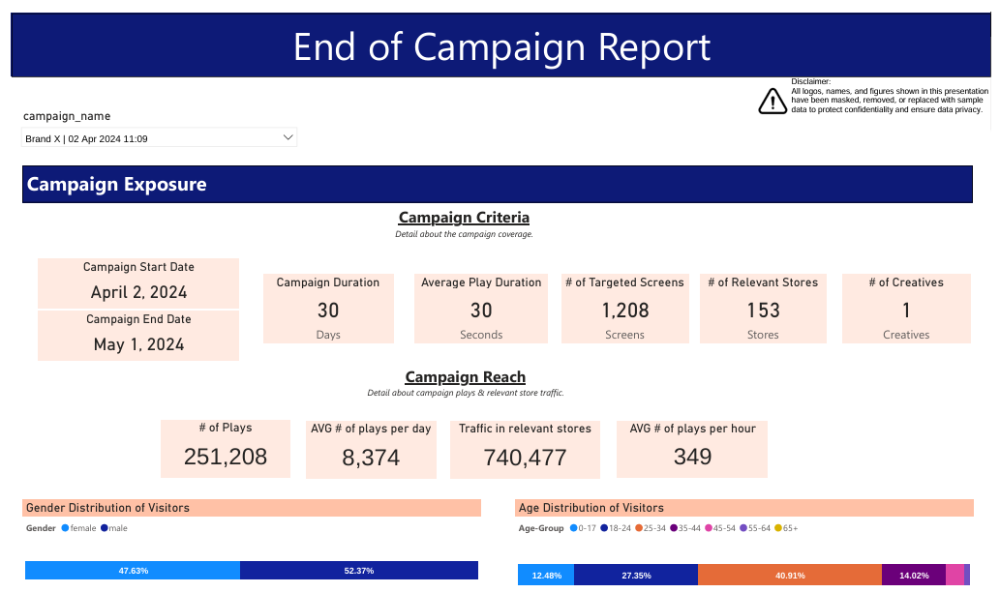
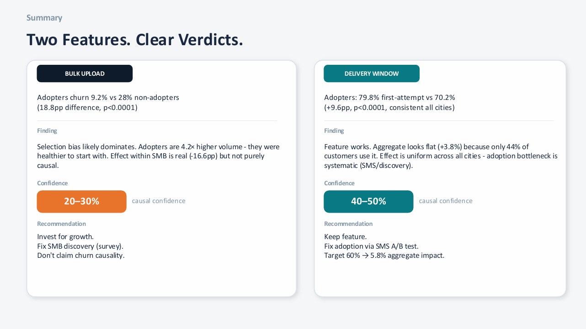
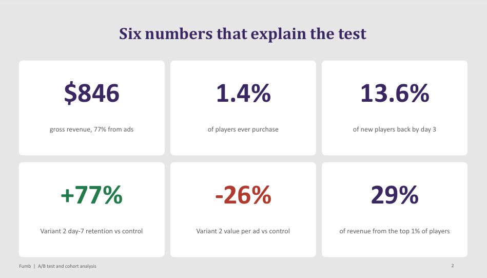
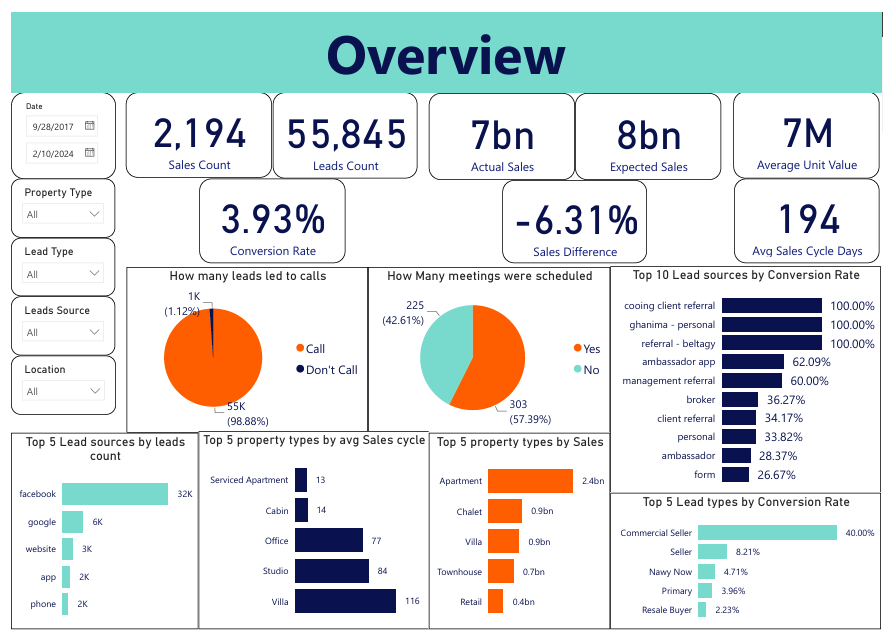

# Aliaa Sakr | Senior Data Analyst

Senior data analyst across retail, advertising, real estate, gaming, and HR. I built the main sales dashboard of a large electronics retailer, planned and measured a new advertising product from tracking plan to launch review, and run A/B tests and statistical analysis in Python and SQL. I also have data science and AI experience: machine learning models and explainable AI with SHAP.

**Contact:** aliaasakr16@gmail.com | [LinkedIn](https://www.linkedin.com/in/aliaa-sakr-4b33091b6/)

---

## What You Will Find Here

Each project below is a real business question, answered end to end: the problem, the dashboards, the insights, the recommendations, and the challenges along the way. Every project page follows the same layout, so you can read the top for the story or scroll down for the technical detail.

**Data privacy:** client and company data is private. Names, logos, and figures in these files are masked or replaced with sample data, and raw data is not published. The projects show the method and the thinking, and the numbers are not real results.

## Featured Projects

<table>
<tr>
<td width="260"></td>
<td><b><a href="retail-business-rhythms">Retail Business Rhythms (RBR)</a></b> The main sales dashboard for a company where retail is the main revenue stream, used from the CEO to branch managers. Rebuilt with finance- and planning-aligned definitions and refreshed several times a day, with an interactive 80/20 product tool. <i>Power BI, DAX, SQL, Python</i></td>
</tr>
<tr>
<td width="260"></td>
<td><b><a href="brandshop-launch-analytics">Brandshop: Tracking Design, Dashboards and Launch Analysis</a></b> Planned the measurement for a new advertising product, a brand's own shop inside a retailer's website and app, then built the dashboards and reviewed the launch. <i>Amplitude, Excel, PowerPoint</i></td>
</tr>
<tr>
<td width="260"></td>
<td><b><a href="in-store-retail-media-analytics">In-Store Retail Media: Campaign Reporting and Ad Effectiveness</a></b> Reported and assessed advertising on in-store screens: whether screens are seen, and whether campaigns sell. <i>Power BI, SQL, Python</i></td>
</tr>
<tr>
<td width="260"></td>
<td><b><a href="product-feature-impact-analysis">Product Feature Impact Analysis</a></b> Separated real feature effects from selection bias for two launches, and showed why a flat overall number hid a strong effect. <i>Python, statistical analysis</i></td>
</tr>
<tr>
<td width="260"></td>
<td><b><a href="mobile-game-ab-test-and-cohort-analysis">Mobile Game A/B Test and Cohort Analysis</a></b> Compared two game variants against a control on retention and monetization, and found that each wins on a different metric. <i>Python, Power BI, SQL</i></td>
</tr>
<tr>
<td width="260"></td>
<td><b><a href="real-estate-leads-and-sales-analysis">Real Estate Leads and Sales Analysis</a></b> Traced where leads become signed contracts: lead volume doubled while yield weakened, and the biggest lead sources were the weakest. <i>Power BI, DAX, SQL</i></td>
</tr>
</table>

## All Projects

### Retail

| Project | What it answers | Tools |
|---|---|---|
| [Retail Business Rhythms (RBR)](retail-business-rhythms) | One trusted view of sales for the whole company, plus Black Friday and brand analyses | Power BI, SQL, Python |
| [Youth Store Format Analytics](youth-store-format-analytics) | Is a new small store format growing, who does it reach, and where to invest? | Power BI, SQL |
| [Loyalty Program Analytics](loyalty-program-analytics) | How the loyalty program performs: redemptions, stretch and discount, and category differences | Power BI, SQL |
| [Customer Survey Insights](customer-survey-insights) | Why shoppers leave without buying, from an in-store survey of non-buyers | Power BI, SQL, Google Sheets |
| [Tech Care Service Analytics](tech-care-service-analytics) | How a new in-store service sells, and where it attaches to product sales | Power BI, SQL |

### Advertising

| Project | What it answers | Tools |
|---|---|---|
| [Brandshop Launch Analytics](brandshop-launch-analytics) | How to measure and launch a brand shop inside a website and app | Amplitude, Excel |
| [In-Store Retail Media](in-store-retail-media-analytics) | Whether screens are seen and campaigns sell, with a quarterly review | Power BI, SQL, Python |
| [Store Profiling and Targeting](store-profiling-and-targeting) | Scoring stores for advertisers, and testing audience targeting | Power BI, SQL, Python |
| [Online Campaign Performance and Reporting](online-campaign-performance-reporting) | Whether banners, search ads, and notifications drive sales | Amplitude, Firebase, Meta Ads |
| [Screen Data Pipeline](screen-data-pipeline) | Automating ad play and audience logs into SQL every day | Python, SQL Server |

### Product Analytics

| Project | What it answers | Tools |
|---|---|---|
| [Product Feature Impact Analysis](product-feature-impact-analysis) | Did two product features work, or was it selection bias? | Python |
| [Mobile Game A/B Test and Cohort Analysis](mobile-game-ab-test-and-cohort-analysis) | Which game variant keeps players and earns money | Python, Power BI, SQL |

### Sales and Real Estate

| Project | What it answers | Tools |
|---|---|---|
| [Real Estate Leads and Sales Analysis](real-estate-leads-and-sales-analysis) | Which leads become sales, how fast, and what is waiting in the pipeline | Power BI, SQL |
| [Real Estate Listing Channel Performance](real-estate-listing-channel-performance) | Is the listing channel still pulling its weight, and where does lead quality leak? | Looker Studio, SQL, GA4, Mixpanel |
| [Sales Pipeline Performance Analysis](sales-pipeline-performance-analysis) | Why a growing pipeline converts only one in four decided deals | Power BI |

### HR and Research

| Project | What it answers | Tools |
|---|---|---|
| [HR Employee Attrition Analysis](hr-employee-attrition-analysis) | Where and why employees leave, and a star-schema data model | Power BI, Python, SQL Server |
| [Recruitment Funnel Analysis](recruitment-funnel-analysis) | Where candidates drop out and how to hire faster | Power BI, SQL |
| [Farmer Survey Insights and Recommendations](farmer-survey-insights-and-recommendations) | What worries farmers, what blocks them from help, and how to reach them | Google Sheets, PowerPoint |

### Machine Learning

| Project | What it does | Tools |
|---|---|---|
| [Heart Failure Risk Prediction](heart-failure-risk-prediction) | A classification model for heart failure risk, tuned for recall, with SHAP explanations of each prediction | Python, scikit-learn, SHAP |
| [House Price Prediction](house-price-prediction) | A pipeline using feature engineering, PCA, and model stacking to predict residential house prices | Python, scikit-learn, pandas, NumPy |

## Tools and Methods

- **Dashboards and BI:** Power BI (DAX, Power Query), Tableau, Looker Studio, Excel
- **Data and code:** SQL, SQL Server, Python (pandas, NumPy, SciPy, scikit-learn, SHAP, matplotlib, seaborn, SQLAlchemy, requests)
- **Product and marketing analytics:** Amplitude, GA4, Mixpanel, Firebase, Meta Ads, Google Sheets
- **Statistical analysis and methods:** hypothesis testing, A/B testing, cohort and funnel analysis, selection bias and causal reasoning, forecasting, store and customer segmentation
- **Machine learning and AI:** classification and regression, feature engineering, PCA, model stacking, explainable AI (SHAP)
- **Data engineering:** star-schema data modeling, tracking plans, automated and scheduled data pipelines

## How Each Project Page Is Organized

1. **The Business Problem:** what the business needed
2. **The Short Answer:** the result in a few lines
3. **Dashboards, insights, and recommendations:** what the data said and what to do
4. **Approach and challenges:** how it was built, and what was hard
5. **Files:** the reports, dashboards, and code included
6. **What to know:** limits and caveats

## About Me

I am a Senior Data Analyst. I have worked as an analyst across animation production, a large electronics retailer (retail, advertising, and a new brand-shop product), real estate, and I now work as a freelancer.

My work covers four areas: dashboards that whole companies use, product and marketing analytics (tracking plans, A/B tests, cohorts, and campaign measurement), data engineering (star schemas and automated pipelines), and data science and AI (machine learning models with explainability). Statistical analysis runs through all of it, from testing whether a feature really worked to checking that a number can be trusted.

## Contact

[GitHub](https://github.com/AliaaSakr) · [Email](mailto:aliaasakr16@gmail.com) · [LinkedIn](https://www.linkedin.com/in/aliaa-sakr-4b33091b6/)
