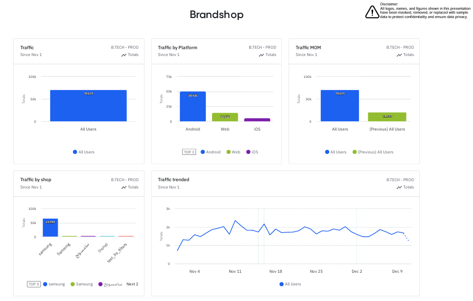
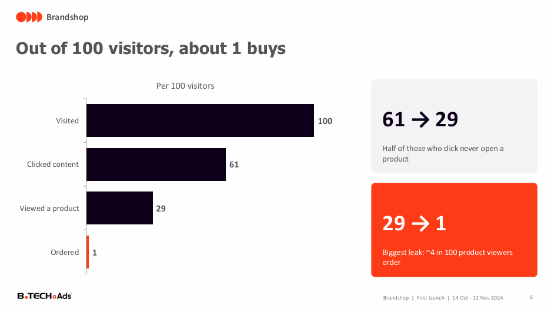
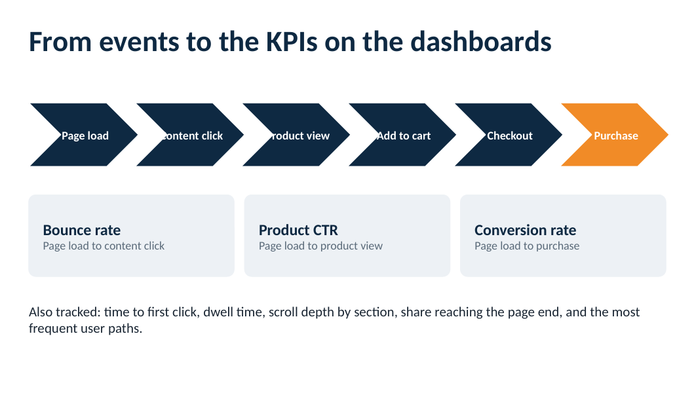

# Brandshop: Tracking Design, Dashboards & Launch Analysis

**How do you launch a brand's own shop inside a retailer's website and app, and know whether it works?**

| | |
|---|---|
| **Industry** | Retail / Advertising Technology |
| **Role** | Senior Data Analyst: involved from planning, event naming, and design through dashboards and launch insights |
| **Tools** | Amplitude Analytics, Excel, PowerPoint |
| **Deliverables** | Tracking plan and measurement framework, 2 Amplitude dashboards, launch review deck, measurement plan deck |
| **Recognition** | Company recognition certificate for this project |
| **Data & Privacy** | Logos, names, and most figures are masked or replaced with sample data. |

---

## 1. The Business Problem

A large electronics retailer built **Brandshop**: a dedicated space inside its website and app where an electronics brand gets a shop designed for it, with all its products, much like the brand's own website. It was a new advertising product, so nothing existed to measure it.

The questions were:
- What should we track, and how should events be named so every brand shop can be measured the same way?
- Is the first launch working, and where do shoppers drop out?
- What should change before the next brand launches?

## 2. The Short Answer

**The first launch drew traffic and real engagement once the setup changed, but only about 1 visitor in 100 ordered, and the web version barely worked.**

| Signal | What the data shows |
|---|---|
| Launch size | 25,019 sessions in the first 30 days (14 Oct to 12 Nov 2024), 1.05% of visitors ordered |
| The turning point | From 1 Nov, traffic jumped about 5x (about 320 to about 1,650 visits a day) and 78% of all sessions came in the last 12 days |
| Engagement | Over the same switch, product CTR rose from 3.9% to 39% and bounce rate fell from 36% to 28% |
| Platforms | iOS converts 2.6x better than Android on only 7% of traffic, while web visitors rarely view a product (1.3% vs 46-52% in the apps) |
| Biggest leak | Out of 100 visitors, 61 click, 29 view a product, and about 1 orders |

## 3. What I Built

1. **Tracking plan and event naming:** a set of five reusable events with properties for brand, section, component, and order, so every brand shop is measured the same way.
2. **KPI framework:** eleven metrics, each with a comparison and an audience (shared with brand partners or internal only).
3. **Two Amplitude dashboards:** one for all brand shops (traffic, platform split, trends, bounce, click and conversion funnels, time to click, dwell time, page-end reach, and user journeys) and one for a single brand shop, which adds scroll depth by section.
4. **A launch review deck** with insights, recommendations, and targets for the next launch.
5. **A measurement plan deck** that documents the metrics, events, and how events become KPIs.

## 4. Key Insights

- **What worked on 1 November made the difference.** Traffic rose about 5x, visitors started engaging, and conversion tripled from 0.4% to 1.3%. The first 18 days ran at only about 320 visits a day.
- **Apps convert, web does not.** Web is 41% of traffic but only 1.3% of web visitors view a product, versus 46-52% in the apps. This may point to a tracking or layout problem and should be audited.
- **iOS is the best shopper.** It converts at 2.84% (vs 1.08% Android and 0.70% web) on only 7% of traffic.
- **The last mile is the leak.** Visitors engage (61 of 100 click), but only about 4 in 100 who view a product order.
- **Half of those who click never open a product,** so landing content is not leading people to items.

## 5. Recommendations

1. **Lock in the 1 November setup** as the day-one default for every brand shop.
2. **Fix the web experience:** audit product-view tracking and the shop layout.
3. **Lean into iOS** by promoting the shop to the highest-converting audience.
4. **Close the last mile** with brand deals, bundles, and price badges at the product view.
5. **Launch at full speed from day one,** and track every KPI daily by platform.

**Targets for the next launch:** at least 2,000 visits a day, bounce rate of 25% or less, product CTR of 45% or more, time to click of 7 seconds or less, and conversion of 2% or more.

## 6. Approach

1. **Planned the measurement first:** defined the metrics, what each one is compared against, and who sees it.
2. **Designed the tracking:** replaced brand-specific event names with five generic events and properties.
3. **Built the Amplitude dashboards** for traffic, engagement, funnels, and journeys, with one view for all shops and one per brand.
4. **Reviewed the launch** by period (before and after 1 November), platform, and funnel step.
5. **Wrote recommendations and targets,** and documented the plan in a measurement plan deck.

## 7. Challenges

- **A new product with no baseline.** No comparable metrics existed, so I compared the shop against the brand's pages and ads elsewhere on the site.
- **Event design that had to scale.** Names that embedded brand and category would not work for the next brand, which led to generic events with properties.
- **A slow start.** Almost four-fifths of sessions arrived in the last 12 days, so full-period averages hide the real picture. I compared before and after 1 November.
- **Tracking gaps.** Missing view events in the first plan, and a web product-view rate that looks too low, meant checking the tracking before trusting some numbers.

## 8. Files

| File | What it is |
|---|---|
| [`Brandshop_Dashboard.pdf`](reports/Brandshop_Dashboard.pdf) | Amplitude dashboard for all brand shops |
| [`Brandshop_Brand_Dashboard.pdf`](reports/Brandshop_Brand_Dashboard.pdf) | Amplitude dashboard for one brand's shop |
| [`Brandshop_Launch_Insights.pdf`](reports/Brandshop_Launch_Insights.pdf) | Launch review: insights, recommendations, targets |
| [`Brandshop_Measurement_Plan.pdf`](reports/Brandshop_Measurement_Plan.pdf) | Measurement plan and tracking design |

## 9. What to Know Before Using This

- Figures are masked or sample data. The project shows the method and the thinking.
- The review covers one brand's first launch, so findings may differ for other brands.
- Results describe the first 30 days and show association, not proof of cause.
