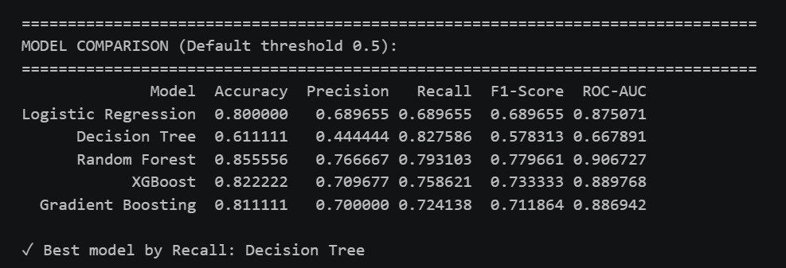
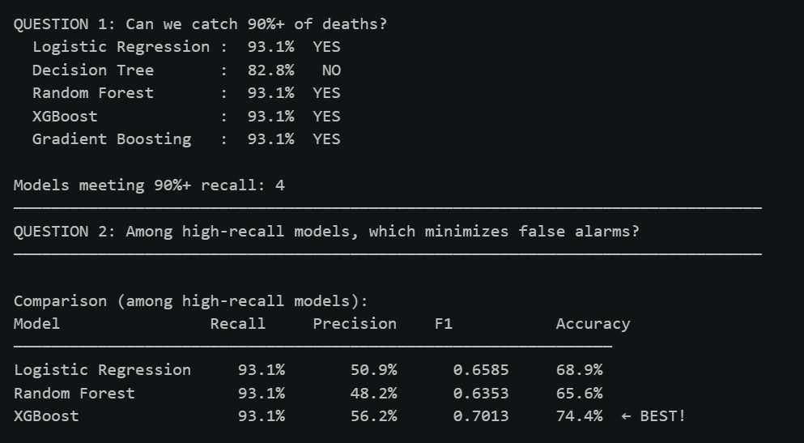
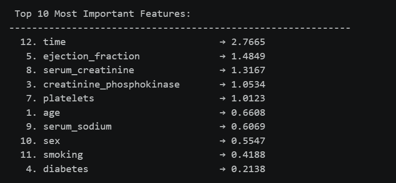
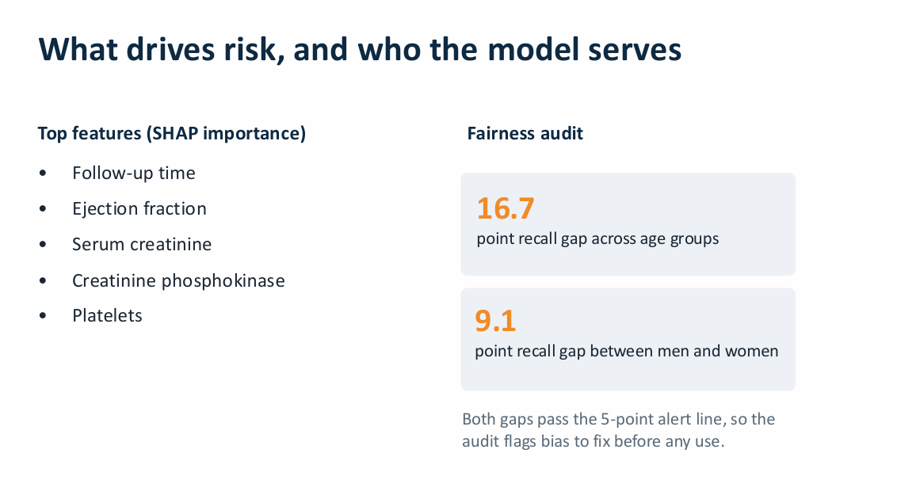

# Heart Failure Risk Prediction: Catching High-Risk Patients, With Explanations

**Can a model flag the patients most likely to die, miss as few as possible, and explain why?**

| | |
|---|---|
| **Industry** | Healthcare analytics |
| **Role** | Data Science project |
| **Tools** | Python (pandas, NumPy, scikit-learn, XGBoost, SHAP, matplotlib, seaborn) |
| **Deliverables** | Analysis notebook, summary deck (PDF) |
| **Data & Privacy** | A public clinical dataset of 299 heart failure patients. |

---

## 1. The Business Problem

Cardiovascular disease is a leading cause of death worldwide, and early detection saves lives. This project builds a model that predicts whether a heart failure patient will die or survive, using 12 clinical measurements such as age, ejection fraction, and serum creatinine.

In a clinical setting the two kinds of mistake are not equal. **Missing a high-risk patient is far worse than raising a false alarm**, so the model is judged on **recall** (the share of actual deaths it catches) and not on accuracy alone. It also has to be explainable, because doctors will not trust a black box.

## 2. The Short Answer

**The model can be tuned to catch more than 90% of deaths, and it shows doctors which factors drive each prediction. A fairness audit found gaps that must be fixed before any real use.**

| Signal | What the data shows |
|---|---|
| Data | 299 patients, 32% of whom died, so the classes are imbalanced |
| Default threshold | The five models caught between 69% and 83% of deaths |
| After threshold tuning | XGBoost caught 93.1% of deaths with 56.2% precision, the best balance of the models that reached 90% recall |
| What drives risk | Follow-up time, ejection fraction, and serum creatinine lead the SHAP importance ranking |
| Fairness | Recall differs by 16.7 points across age groups and 9.1 points between men and women |
| Readiness | The notebook's own checklist concludes "not fully ready" |

## 3. What I Built

1. **A clean, balanced training setup:** a stratified split, with SMOTE applied to the training data only.
2. **Five models compared:** logistic regression, decision tree, random forest, XGBoost, and gradient boosting.
3. **Threshold tuning for medical use:** a search for the decision threshold that keeps recall at 90% or higher, then a choice among the models that reach it.
4. **Explainability with SHAP:** which features drive risk across all patients, and a breakdown of one patient's risk.
5. **A fairness audit** of recall and precision by age group and gender.
6. **Deployment blueprints:** demo versions of data drift monitoring, hospital record integration, and a shadow-mode trial.

## 4. Key Insights

- **Accuracy hides the real problem.** The decision tree had only 61% accuracy but the highest recall (83%) at the default threshold. No model at the default threshold caught enough deaths for a clinical use.
- **Lowering the threshold is the fix.** Four of the five models reached 93% recall once the threshold was tuned. XGBoost did so with the fewest false alarms (56% precision, 74% accuracy).
- **Kidney function and heart pumping matter.** Serum creatinine and ejection fraction are among the strongest drivers, and older age and shorter follow-up also raise risk.
- **The model works better for some groups than others.** Recall was 100% for ages 60-80 but 83% for ages 80 and over, and 91% for men against 100% for women, from small groups.
- **Fairness checks changed the verdict.** The audit flagged bias in both age and gender, which is why the project is not presented as ready for use.

## 5. Recommendations and Next Steps

1. **Re-test without follow-up time.** It is the top feature, but a doctor would not know it at the time of prediction.
2. **Close the fairness gaps** with more data for under-represented groups and a re-run of the audit.
3. **Get more data.** With 299 patients and a 90-patient test set, every figure carries wide uncertainty.
4. **Validate in practice** with a silent trial alongside doctors before the model influences any decision.

## 6. Approach

1. **Explored the data:** class balance, age, diabetes, and correlations with the outcome.
2. **Prepared it:** a stratified 70/30 split, SMOTE on the training data, and scaling.
3. **Trained and compared five models** on recall, precision, F1, accuracy, and ROC-AUC.
4. **Tuned the threshold** for at least 90% recall and picked the model with the best balance.
5. **Explained and audited:** SHAP importance and single-patient explanations, then recall and precision by age and gender.
6. **Documented a deployment plan** covering drift monitoring, record integration, and a shadow trial.

## 7. Challenges

- **Imbalanced classes.** Only about a third of patients died, so I balanced the training data and judged models on recall.
- **A very small dataset.** The test set has 90 patients, so results can swing, and subgroup results rest on very few people.
- **Accuracy versus safety.** The best accuracy and the best recall came from different models, so the choice depends on what mistakes cost.
- **Honest readiness.** The deployment pieces are demos, and the fairness audit failed, so the project is documented as not ready for use.

## 8. Files

| File | What it is |
|---|---|
| [`heart_failure_risk_prediction.ipynb`](code/heart_failure_risk_prediction.ipynb) | Full analysis: exploration, models, threshold tuning, SHAP, fairness audit |
| [`Heart_Failure_Risk_Prediction_Summary.pdf`](reports/Heart_Failure_Risk_Prediction_Summary.pdf) | Summary deck |

## 9. What to Know Before Using This

- This is a learning and portfolio project on a small public dataset. It is **not a medical device** and must not be used for clinical decisions.
- Drift monitoring, hospital record integration, and shadow mode are demonstrations, not live systems.
