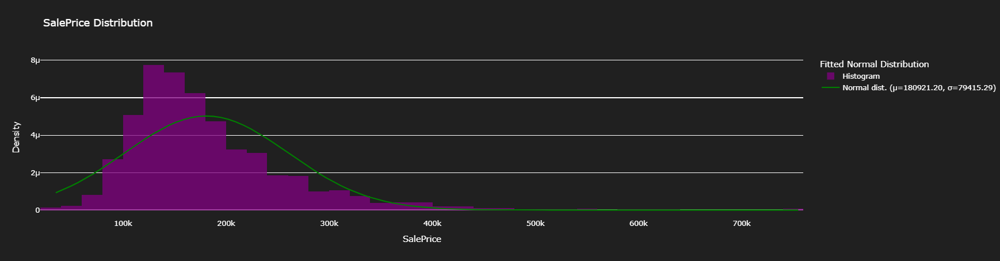
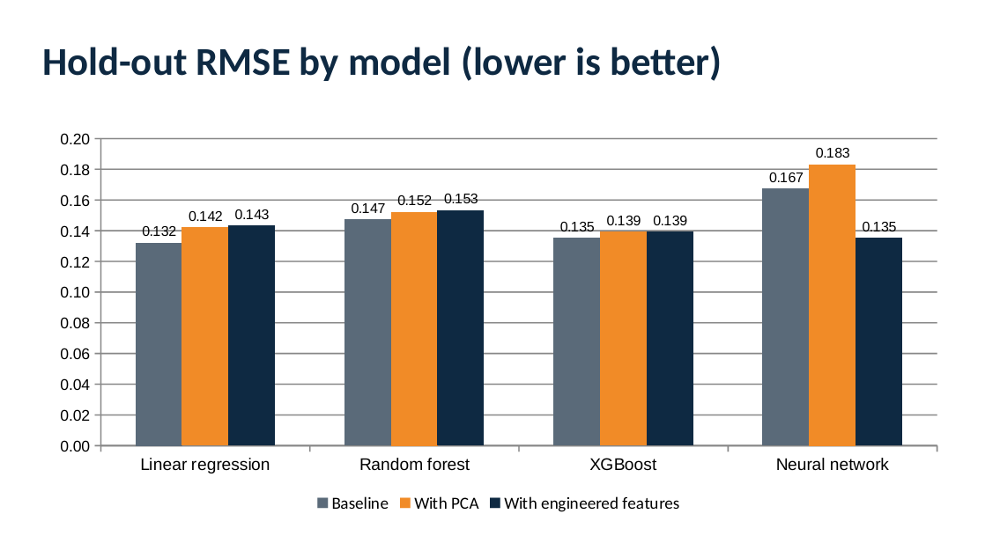
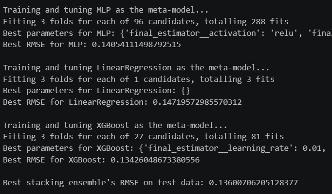

# House Price Prediction: Feature Engineering, PCA and Model Stacking

**Which modeling steps actually improve house price predictions, and which only look like they do?**

| | |
|---|---|
| **Industry** | Real estate |
| **Role** | Data Science project |
| **Tools** | Python (pandas, NumPy, scikit-learn, XGBoost, SciPy, Plotly) |
| **Deliverables** | Analysis notebook, summary deck (PDF) |
| **Data & Privacy** | A public housing dataset of 1,460 homes and 81 columns. |

---

## 1. The Business Problem

Pricing a home well means weighing dozens of features at once: size, age, quality, location, and condition. This project predicts residential sale prices from 80 features, using a public housing dataset, and tests which steps help: tuning, dimensionality reduction (PCA), engineered features, and stacking several models together.

Prices are predicted on a log scale and scored with RMSE (lower is better).

## 2. The Short Answer

**Careful preprocessing and tuning matter most. PCA did not help on unseen data, engineered features helped the neural network the most, and the final stack landed close to the best single models.**

| Step | What happened |
|---|---|
| Baseline (tuned models) | Cross-validated RMSE of 0.176 for linear regression, 0.153 for random forest, and 0.138 for XGBoost |
| PCA | Small gains in cross-validation, but **worse hold-out RMSE for every model** |
| Engineered features | Neural network hold-out RMSE improved from 0.167 to 0.135, the biggest gain of any step |
| Stacking | Linear regression, XGBoost, and a neural network stacked to about 0.135, similar to the best single models |
| Caveat | On the one hold-out split, plain linear regression scored 0.132, so the gains are modest |

## 3. What I Built

1. **Exploration with seven questions:** price by dwelling type, zoning, street and alley access, lot shape, property age, living area, and year.
2. **One reusable pipeline** that fills missing values, scales numbers, and one-hot encodes categories, so the same steps apply to training and new data without leakage.
3. **Four tuned models** using grid search: linear regression, random forest, XGBoost, and a neural network.
4. **A PCA experiment** to reduce the number of features.
5. **Feature engineering:** total square footage, property age, total bathrooms, and flags for remodeled, second floor, and garage.
6. **Ensembling and stacking** to combine the best models.

## 4. Key Insights

- **Pipelines protect the result.** Putting every preprocessing step inside one scikit-learn pipeline keeps validation data out of training and avoids leakage.
- **Tree models beat linear models in cross-validation,** with XGBoost the best single model (RMSE about 0.138, against 0.176 for linear regression).
- **PCA is not a free win.** It slightly improved cross-validated scores, but hold-out RMSE rose for every model (for example, 0.135 to 0.139 for XGBoost and 0.167 to 0.183 for the neural network).
- **Better inputs beat fancier models.** Engineered features took the neural network from the weakest model to the best single one on the hold-out split (0.135).
- **A stack is more stable than one model,** though the lowest score may be too good to trust. The stack's 0.135 is the more realistic figure.
- **One split can mislead.** Linear regression looked weakest in cross-validation (0.176) yet scored best on the single hold-out split (0.132), which is a warning to compare setups with repeated validation.

## 5. Recommendations and Next Steps

1. **Compare setups with repeated cross-validation** instead of one split.
2. **Keep PCA only if speed matters,** since it did not improve accuracy on unseen data.
3. **Check the neural network and the stack for overfitting** before trusting the lowest score.
4. **Try the engineered features on simpler models too,** where they may help as well.

## 6. Approach

1. **Explored and cleaned the data:** missing values, skew in the sale price, and outliers.
2. **Built the preprocessing pipeline** with imputation, scaling, and one-hot encoding.
3. **Tuned four models** with 3-fold grid search and compared RMSE.
4. **Re-ran the models after PCA** and compared both setups.
5. **Engineered features,** rebuilt the pipeline, and re-tuned the models.
6. **Averaged and stacked the best models,** then converted predictions back to dollars for a competition-style submission file.

## 7. Challenges

- **Skewed prices.** Predicting on a log scale made errors comparable across cheap and expensive homes.
- **Many categories and missing values.** The pipeline handles them the same way for training and new data.
- **Honest comparison.** Cross-validation and the hold-out split disagreed, so I report both instead of picking the flattering one.
- **Overfitting risk.** The neural network scored well after feature engineering, so the stack is the more cautious final answer.

## 8. Files

| File | What it is |
|---|---|
| [`house_price_prediction.ipynb`](code/house_price_prediction.ipynb) | Full analysis: exploration, pipeline, tuning, PCA, features, stacking |
| [`House_Price_Prediction_Summary.pdf`](reports/House_Price_Prediction_Summary.pdf) | Summary deck |

## 9. What to Know Before Using This

- This is a learning and portfolio project on a public dataset, not a production pricing tool.
- Scores are RMSE on log prices, so they are not dollar errors.
