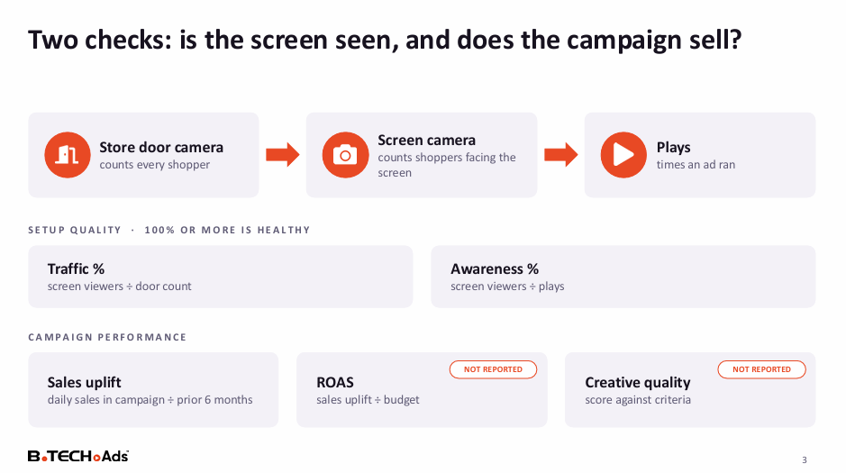
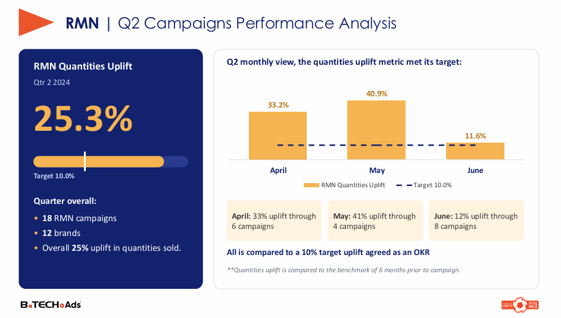

# In-Store Retail Media: Campaign Reporting, Ad Effectiveness & Quarterly Review

**Are our in-store screens being seen, and do the campaigns on them actually sell?**

| | |
|---|---|
| **Industry** | Retail / Advertising Technology |
| **Role** | Data Analyst |
| **Tools** | Power BI (DAX, Power Query), SQL, Python, Excel, PowerPoint |
| **Deliverables** | Campaign report dashboard, store campaign report (client deck), ad effectiveness assessment, quarterly campaign review |
| **Data & Privacy** | Logos, names, and figures are masked or replaced with sample data. The Power BI file is not included. |

---

## 1. The Business Problem

A large electronics retailer sells advertising space on **screens inside its stores** to electronics brands. Each campaign needed to be reported to the brand, and the retailer needed to know whether the screens and the campaigns were working.

The questions were:
- How do we report each campaign's reach and sales impact to the brand clients?
- Are the screens actually seen by shoppers, and do campaigns lift sales?
- How did all campaigns perform in the quarter against the agreed targets?

## 2. The Short Answer

**Most campaigns lift sales, but many screens leak reach, and more ad plays do not mean more sales.**

| Signal | What the data shows |
|---|---|
| Campaigns | 25 of 36 campaigns (69%) grew average daily sales against the previous 6 months |
| Screen visibility | 46% of screens see fewer people than walk into the store, and 71 screens have no baseline at all |
| Wasted plays | 67% of screens (527 of 789) play more ads than the viewers they reach |
| Volume vs results | The biggest campaign (1.97M plays) lost 16% of sales volume, while a 344K-play campaign gained 18% |
| Quarterly result | 18 campaigns across 12 brands delivered a 25% uplift in quantities sold, against a 10% target |

## 3. What I Built

1. **End-of-campaign dashboard (Power BI):** combines the screen system's play data with the retailer's own sales database. For each campaign it shows coverage (dates, screens, stores, creatives), reach (plays, plays per day and hour, store traffic), visitor gender and age, plays by store and hour, shopping behavior by category, and brand sales and share compared with the 6 months, 2 months, and same-length period before.
2. **Store campaign report (client deck):** a standard report sent to each brand after its campaign, following the purchase funnel from reach to awareness, decision, and purchase.
3. **Ad effectiveness assessment:** a deeper check on the screens and campaigns, with recommendations.
4. **Quarterly campaign review:** one deck that summarizes in-store and online campaigns against the quarter's targets, with insights and recommendations.

## 4. Key Insights

**From the ad effectiveness assessment**
- **Screens miss the crowd.** Only 45% of screens see as many people as the store's door camera counts. 361 screens see fewer, and some read above 100%, which needs verifying.
- **Same store, very different screens.** In one store, seven screens ranged from 23% to 388% of store traffic.
- **Some screens see almost no one.** 12 of the 15 lowest screens reviewed capture under 5% of store traffic, and one logged a single viewer against over 150,000 store visits.
- **Plays are not the answer.** Brand share moved the same way as sales in the four largest campaigns, regardless of how many plays each one had.
- **A well-paced campaign can still miss the crowd.** One refrigerator creative was paced well (96% of screens kept up with plays), but 91% of its screens saw fewer people than walked in.

**From the quarterly review**
- **In-store campaigns beat the target.** Uplift was 33% in April, 41% in May, and 12% in June against a 10% target. June was lowest because three campaigns with large declines all ran that month.
- **Low-share brands gain most.** Brands with a small share of the retailer's sales saw uplifts of up to 280%, while a high-share brand fell 15% in a category that dropped 18%.
- **Context matters.** The overall retail environment affected results more than the campaigns' own design, so results are measured against a benchmark, not read on their own.
- **Channels suit different products.** Smartwatches worked online, while a small-appliance brand did better in store.

## 5. Recommendations

1. **Audit the dead screens.** Check cameras and angles on screens under 5% of traffic or with no viewer data.
2. **Re-aim low-traffic screens,** worst first.
3. **Trim wasted plays** by moving plays from screens that have more plays than viewers to those that keep pace.
4. **Measure the full picture:** verify readings above 100%, and report return on ad spend and creative quality for every campaign.
5. **Plan on audience and creative fit,** not on play volume.
6. **For the quarter:** prioritize low-share brands, judge online campaigns with several lenses, and match the channel to the category.

**30-day plan:** weeks 1-2 audit and fix screens; week 3 re-aim and rebalance plays; week 4 re-measure traffic, awareness, and sales uplift.

## 6. Approach

1. **Combined two data sources:** campaign and screen data from the screen system, loaded into SQL (see the screen data pipeline project), and sales data from the retailer's database. Screen and store mapping sheets linked the two.
2. **Defined the metrics:** reach, awareness, uplift in quantities sold against a benchmark period, brand contribution, and for screens, **Traffic %** (screen viewers divided by door count) and **Awareness %** (screen viewers divided by plays).
3. **Built the Power BI dashboard** with Power Query and DAX, and a repeatable report deck for clients.
4. **Assessed screens and campaigns** at the screen, store, and campaign level.
5. **Reported quarterly** against the targets agreed as team goals.

## 7. Challenges

- **Joining two systems.** Screen and sales data came from different sources with different store and screen names, so mapping sheets were needed to match them.
- **Comparing to what?** Sales move with the season and the market, so I compared each campaign with several periods before it and called out when the whole category fell.
- **Readings that don't add up.** Some screens read above 100% of store traffic and some had no door-camera baseline, so I flagged them for checking and did not rank them.
- **Reporting at scale.** Many campaigns each needed a client report, which led to a standard structure.

## 8. Files

| File | What it is |
|---|---|
| [`Campaign_Report_Dashboard.pdf`](reports/Campaign_Report_Dashboard.pdf) | End-of-campaign Power BI dashboard |
| [`Store_Campaign_Report.pdf`](reports/Store_Campaign_Report.pdf) | Client report for an in-store campaign |
| [`Ad_Effectiveness_Insights.pdf`](reports/Ad_Effectiveness_Insights.pdf) | Ad effectiveness assessment |
| [`Quarterly_Campaign_Review.pdf`](reports/Quarterly_Campaign_Review.pdf) | Quarterly summary of in-store and online campaigns |

## 9. What to Know Before Using This

- All figures are masked or sample data. The project shows the method and the thinking.
- Uplift is measured against earlier periods, so it shows association with a campaign and does not prove the campaign caused it.
- Return on ad spend and creative quality were not yet reported when this assessment was made.
