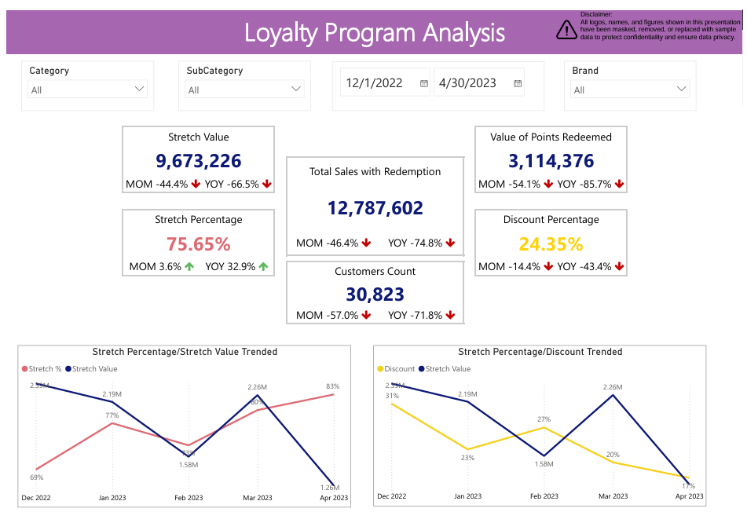

# Loyalty Program Analytics: Redemptions, Stretch and Discount

**Is the loyalty program being used, what is it worth, and how does it behave across categories and brands?**

| | |
|---|---|
| **Industry** | Retail (electronics) |
| **Role** | Retail Data Analyst |
| **Tools** | Power BI (DAX, Power Query), SQL |
| **Deliverables** | Loyalty program dashboard with month-over-month and year-over-year tracking |
| **Data & Privacy** | Logos, names, and figures are masked or replaced with sample data. The Power BI file is not included. |

---

## 1. The Business Problem

A retailer ran a loyalty program in which customers redeem points when they buy. Management needed one place to see **how much customers use it, how much value flows through it, and how it differs by category and brand.**

Each sale with a redemption is split into a **stretch** part and a **discount** part, and the two shares always add up to 100%. The dashboard tracks both, along with the number of customers and the value of the points redeemed.

## 2. The Short Answer

**Use of the program fell sharply against the previous month and year, while the mix moved toward stretch and away from discount.**

| Measure (Dec 2022 to Apr 2023) | Value | vs previous month | vs previous year |
|---|---|---|---|
| Customers | 30,823 | -57.0% | -71.8% |
| Value of points redeemed | 3.11M | -54.1% | -85.7% |
| Sales with a redemption | 12.79M | -46.4% | -74.8% |
| Stretch value | 9.67M | -44.4% | -66.5% |
| Stretch share | 75.65% | +3.6% | +32.9% |
| Discount share | 24.35% | -14.4% | -43.4% |

## 3. The Dashboard

- **Headline cards** for stretch value, points redeemed, sales with a redemption, stretch and discount shares, and customers, each with month-over-month and year-over-year change.
- **Trends** by month for stretch share, stretch value, and discount.
- **Category split** of stretch and discount, with stretch value for each category.
- **Brand view** of stretch value.
- **Tables** by category and sub-category with month-over-month change.

It can be filtered by category, sub-category, brand, and date.

## 4. Key Insights

- **Everything fell together.** Customers, points redeemed, and redemption sales were all well below both the previous month and the previous year. Points redeemed fell faster than the sales they came with.
- **The mix shifted.** The stretch share rose while the discount share dropped sharply, so a bigger part of each redeemed sale was stretch.
- **Categories behave very differently.** Stretch is about 94-96% of value for TVs, large appliances (MDA), and mobiles, 83% for small appliances (SDA), and only 41% for accessories, where discount is the larger share.
- **Small appliances carry the most value.** They produce about 4.0M of stretch value (about 42%), followed by TVs (1.9M), accessories (1.4M), mobiles (1.1M), and large appliances (1.0M).
- **A few rows look wrong.** One category shows a stretch share above 100% (a negative discount) and one has no category at all. They need checking before anyone relies on category-level numbers.

## 5. Recommendations

1. **Find out why usage fell** by splitting the decline into fewer customers, fewer redemptions, and changed rules, by category and brand.
2. **Protect the biggest categories:** small appliances and TVs hold most of the stretch value.
3. **Review accessories,** where discount dominates, to see whether the program is giving away more than it should.
4. **Clean the category data,** including the over-100% and blank rows.
5. **Report stretch and discount shares by brand** monthly, so changes in the mix are caught early.

## 6. Approach

1. **Gathered what management wanted to track** and defined each measure, including the stretch and discount split.
2. **Built the data model** from sales and redemption data with SQL and Power Query.
3. **Wrote the DAX measures,** including month-over-month and year-over-year change for every headline number.
4. **Designed the dashboard** from headline numbers to category, sub-category, and brand detail.

## 7. Challenges

- **Program-specific measures.** "Stretch" and "discount" are the program's own terms, so the dashboard shows how they relate.
- **Comparing periods.** Every number needed a fair month-over-month and year-over-year view.
- **Data quality at category level.** Some rows had shares above 100% or a missing category, which I flagged rather than hid.
- **Reading a decline.** A drop in totals can come from fewer customers or smaller redemptions, so the dashboard shows each separately.

## 8. Files

| File | What it is |
|---|---|
| [`Loyalty_Program_Dashboard.pdf`](reports/Loyalty_Program_Dashboard.pdf) | Loyalty program dashboard |

## 9. What to Know Before Using This

- All figures are masked or sample data. The project shows the method and the thinking.
- Changes against the previous month and year show association, not cause.
- The Power BI file and SQL are not included in this repo.
