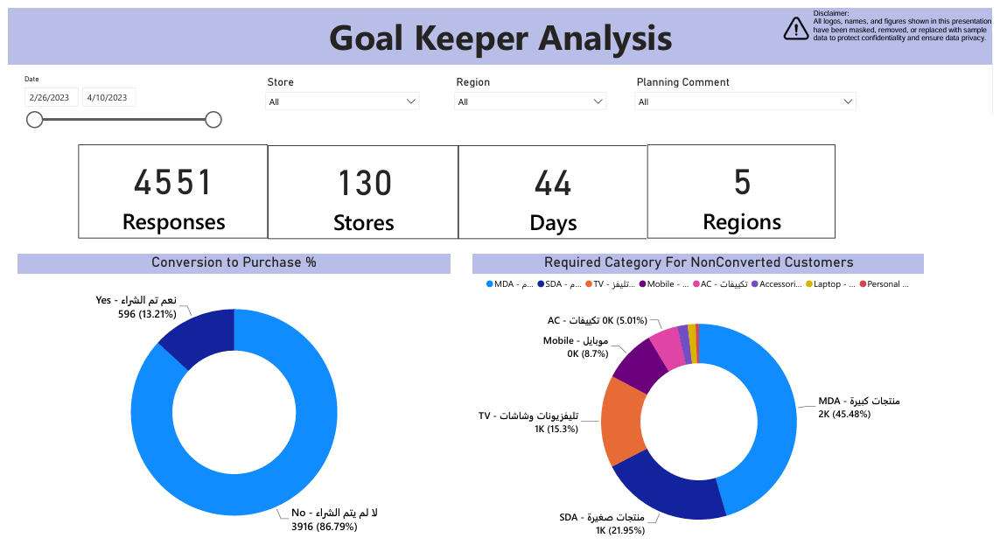

# Loyalty Program & Customer Survey Insights: Why Shoppers Don't Buy and How Rewards Perform

**What stops shoppers from buying, and is the loyalty program doing its job?**

| | |
|---|---|
| **Industry** | Retail (electronics) |
| **Role** | Retail Data Analyst |
| **Tools** | Power BI (DAX, Power Query), SQL, Google Sheets |
| **Deliverables** | In-store survey dashboard (Goal Keeper), loyalty program dashboard |
| **Data & Privacy** | Logos, names, and figures are masked or replaced with sample data. The Power BI files are not included. |

---

## 1. The Business Problem

A retailer wanted to improve the in-store experience and understand its customers beyond the sales numbers. Two questions were open:

1. **Why do people walk out without buying?** Sales data only shows who bought. Nobody knew why the others left.
2. **Is the loyalty program working?** Management needed to see how much customers use it and what it is worth.

## 2. Part 1: Goal Keeper, the In-Store Survey

**The idea.** A staff member in each store, called the "Goal Keeper", asked customers who left **without buying** a few short questions and logged the answers in a form. The answers fed a dashboard for the retail and planning teams. Answers were collected in Google Sheets and analyzed in Power BI.

**Scale (sample data).** 4,551 responses from 130 stores across 5 regions over 44 days (26 February to 10 April 2023).

**What the dashboard shows**
- **Conversion to purchase:** 13.2% of surveyed customers bought (596 of 4,551), and 86.8% did not.
- **Main reason for leaving:** by far the largest is that the product wasn't available (about 73% in the detailed view). Others are installment-financing issues (the largest group of the remaining reasons), questions about offers, delivery, system problems, and branch or staff issues.
- **What non-buyers wanted:** the category they came for, with TVs the largest (about 45%), followed by small and large appliances.
- **By store, region, and cluster:** conversion and reasons for each store, so every branch can see its own picture, and a planning comment field for follow-up.

**Why it matters.** Most walkouts were not caused by price or staff, but by availability. That is a stock and planning problem, and it is something stores can't fix on their own.

## 3. Part 2: Loyalty Program Analysis

The dashboard tracks the program from December 2022 to April 2023.

- **Size and value:** 30,823 customers, about 3.1M in points redeemed, and 12.8M in sales that included a redemption.
- **Stretch vs discount:** every redeemed sale is split into "stretch" and "discount". The stretch share was 75.65% of the value, the rest being discount.
- **By category:** the stretch share ranges from about 41% on accessories to over 90% on TVs, mobiles, and large appliances, so the program behaves very differently by category.
- **Trends:** monthly stretch value, stretch share, and discount share over time, and a view by brand and sub-category.
- **Sharp decline:** stretch value, points redeemed, redemption sales, and customer counts were all sharply lower than the previous month and the previous year.

## 4. Recommendations

1. **Fix availability first.** Share the survey's top missing products with planning, and track availability by store.
2. **Make the survey routine** with a short form, a weekly review, and a reply from planning on each comment.
3. **Review financing friction.** Installment-financing questions and rejections are the next biggest reason, so improve guidance at the till.
4. **Investigate the loyalty decline** by category and brand to see whether it comes from fewer customers, fewer redemptions, or the program's rules.
5. **Tailor the program by category,** since stretch behavior differs so much between accessories and big-ticket items.

## 5. Approach

1. **Designed the survey flow** with the retail team: questions, answer options, and a simple form for store staff.
2. **Collected and cleaned the responses** in Google Sheets, translating bilingual answer options into clear categories.
3. **Built the Goal Keeper dashboard** in Power BI, with SQL and Power Query for the data and DAX for the measures.
4. **Grouped reasons** into a small set of classes (availability, installment financing, inquiry, delivery, system, branch, staff) so they could be acted on.
5. **Built the loyalty dashboard** from sales and redemption data, with category and brand views.

## 6. Challenges

- **Survey data is messy.** Answers came in two languages with many free-text variations, so I grouped them into clear reason classes.
- **A biased sample.** Only customers who didn't buy were asked, so the survey explains walkouts and not satisfaction overall.
- **Staff effort.** Surveys depend on a person asking, so coverage varied by store, and I showed response counts next to every result.
- **Program-specific measures.** "Stretch" and "discount" are the loyalty program's own terms, so the dashboard explains them and shows how they relate.

## 7. Files

| File | What it is |
|---|---|
| [`Goal_Keeper_Survey_Dashboard.pdf`](reports/Goal_Keeper_Survey_Dashboard.pdf) | In-store survey dashboard |
| [`Loyalty_Program_Dashboard.pdf`](reports/Loyalty_Program_Dashboard.pdf) | Loyalty program dashboard |

## 8. What to Know Before Using This

- All figures are masked or sample data. The project shows the method and the thinking.
- The survey covers only customers who did not buy, so it shows reasons for walkouts, not overall satisfaction.
- The Power BI files and SQL are not included in this repo.
