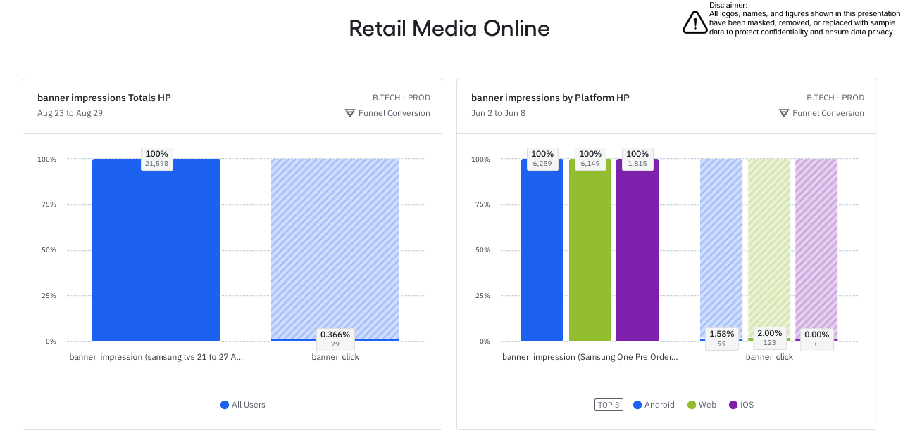
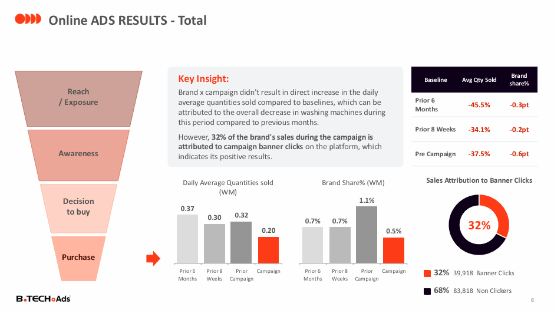

# Online Campaign Performance: Retail Media Dashboard & End-of-Campaign Reporting

**Did the banners, search ads, and notifications on the website and app actually drive sales for the brands?**

| | |
|---|---|
| **Industry** | Retail / Advertising Technology |
| **Role** | Data Analyst |
| **Tools** | Amplitude Analytics, Firebase, Meta Ads, PowerPoint |
| **Deliverables** | Online retail media dashboard (Amplitude), end-of-campaign report for clients |
| **Data & Privacy** | Logos, names, and figures are masked or replaced with sample data. |

---

## 1. The Business Problem

An electronics retailer sells advertising on its **website and mobile apps** to electronics brands: homepage and category banners, sponsored search listings, push notifications, pop-ups, and social media posts. Brands wanted proof of what each campaign achieved, and the retailer needed a repeatable way to measure and report it.

The questions were:
- How many people saw and clicked each ad, and on which platform?
- Did clicks turn into product views and sales?
- How do we report results to brands in a way they trust?

## 2. The Short Answer

**Banner clicks are small in number, but they attribute a meaningful share of a brand's sales, even when the brand's overall sales fall.**

| Signal | What the data shows |
|---|---|
| Attribution | In the sample campaign, 32% of the brand's sales during the campaign came from shoppers who clicked the banner |
| Brand sales vs baseline | Daily quantities sold were below the prior 6 months, but the whole category had fallen, so clicks showed the campaign's value |
| Quarterly result | Across 27 campaigns and 16 brands, sales attributed to banner clicks reached 22% against a 14% target |
| Platforms | Click-through rates differ by platform and placement, so each is reported separately |

## 3. What I Built

1. **Amplitude dashboard "Retail Media Online":** tracks banner impressions and clicks on the homepage and category pages, split by platform (Android, web, iOS); attributed sales for users who clicked a banner; and for sponsored listings, the funnel from search to product view to purchase, by keyword group.
2. **End-of-campaign report (PowerPoint, sent to each brand):** a standard report with campaign details, the results method, banner results by placement, total results against baselines, sponsored listings, push notifications, pop-ups, and organic social posts.

## 4. How Results Are Measured

The report follows the shopper's full journey:

| Stage | Online metric |
|---|---|
| **Reach** (who could see the ad) | Website traffic |
| **Awareness** (who saw it) | Banner views, impressions |
| **Decision** (who was interested) | Clicks and click-through rate |
| **Purchase** (who bought) | Quantities and value of orders from shoppers who clicked |

Sales results are compared with three baselines: the 6 months before, the 8 weeks before, and the period just before the campaign. They are shown next to **sales attribution to banner clicks**, because a campaign can protect sales in a falling category without showing growth.

## 5. Key Insights

- **Clicks can show value when volume does not.** In one campaign, the brand's daily quantities were below every baseline because the category was declining, yet 32% of its sales came from banner clickers.
- **Placement matters.** Category-page banners had a higher click-through rate than homepage carousel slots in the sample report, but with far fewer impressions.
- **Sponsored listing results vary widely** by keyword group, from about 0.1% to 8% of searches leading to a product view in the dashboard sample.
- **Platforms behave differently.** One platform had no clicks at all in a sample week, which is worth checking for tracking issues.
- **Benchmarks change the story.** Against an 8-week baseline, brands looked better than against a 6-month baseline that included a high-season period.
- **Quarterly view:** the attribution target was met (22% vs 14%), even though online quantities uplift was negative in the quarter because overall online sales fell sharply.

## 6. Recommendations

1. **Judge online campaigns with three lenses:** quantities against two baselines and sales attribution to clicks.
2. **Report by platform and placement,** and check platforms with zero clicks.
3. **Put weight on attribution** when the category is falling.
4. **Match the channel to the product:** some categories respond better online and others in stores.
5. **Keep one report structure** so brands can compare campaigns over time.

## 7. Approach

1. **Planned the tracking** with event names for banner impressions, banner clicks, and search, with properties for placement and campaign (the same approach as in the Brandshop project).
2. **Built the Amplitude dashboard** with funnels by platform, period, and keyword group.
3. **Pulled results from Firebase and Meta Ads** for notifications and paid social, and from the retailer's sales data for quantities and brand share.
4. **Designed one report template** that covers every ad type in a campaign.
5. **Compared with baselines** and calculated sales attribution for each campaign.

## 8. Challenges

- **Many ad types, many tools.** Banners, search, notifications, and social posts each report differently, so I created one common structure.
- **Fair baselines.** Seasons and category trends shift sales, so every report shows more than one baseline.
- **Attribution.** Only shoppers who clicked a banner can be tied to it, so I show attributed sales as a clearly labelled measure and not as total impact.
- **Consistency.** A repeatable template and consistent event names made reports quick to produce and easy to compare.

## 9. Files

| File | What it is |
|---|---|
| [`Retail_Media_Online_Dashboard.pdf`](reports/Retail_Media_Online_Dashboard.pdf) | Amplitude dashboard for online ads |
| [`Online_Campaign_Report.pdf`](reports/Online_Campaign_Report.pdf) | End-of-campaign report for a brand |

The combined online and in-store quarterly summary is part of the [in-store retail media project](../in-store-retail-media-analytics).

## 10. What to Know Before Using This

- All figures are masked or sample data. The project shows the method and the thinking.
- Attribution covers shoppers who clicked an ad, so it is not the full effect of the campaign.
- Results from one campaign should not be generalized to every brand or category.
