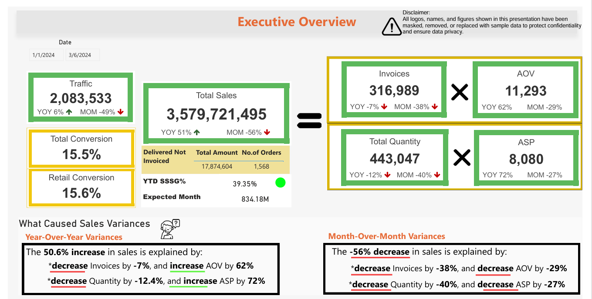
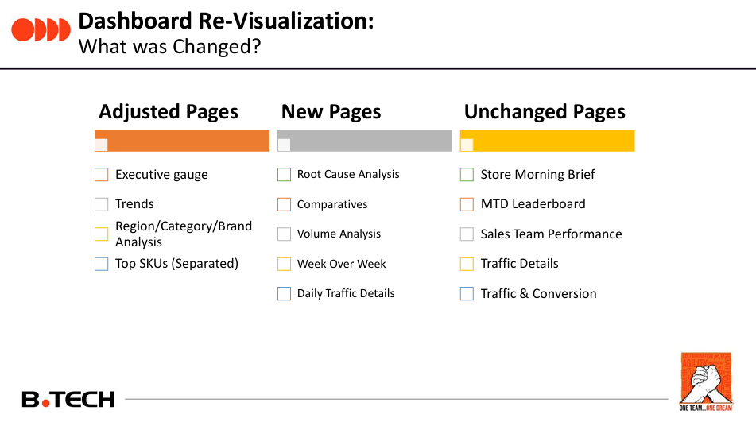
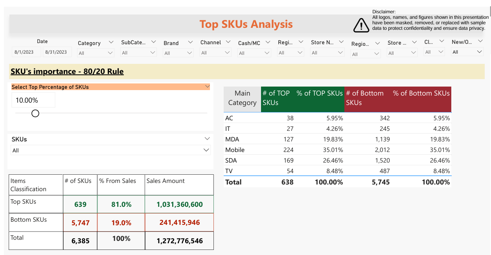
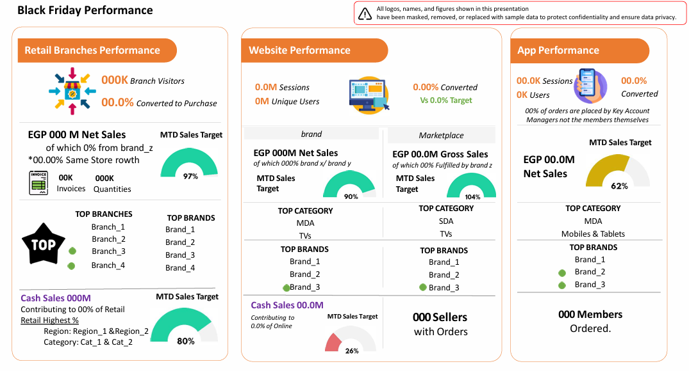

# Retail Business Rhythms (RBR): The Company's Main Sales Dashboard

**One dashboard, one version of the truth, for everyone from the CEO to the branch manager.**

| | |
|---|---|
| **Industry** | Retail (electronics) |
| **Role** | Retail Data Analyst: owned the dashboard and helped lead its rebuild |
| **Tools** | Power BI (DAX, Power Query), SQL, Python, PowerPoint, Excel |
| **Deliverables** | 9-page dashboard, rebuilt version, interactive Top SKUs tool, Black Friday and brand performance analyses |
| **Data & Privacy** | Logos, names, and figures are masked or replaced with sample data. The Power BI file is not included. |

---

## 1. The Business Problem

Retail is **company's main revenue channel**, so almost every department needed to see how it was doing: the CEO and other executives, retail, marketing, planning, and finance. Each group asked similar questions and often got different numbers.

The company needed **one trusted dashboard** that was:
- Detailed enough for a branch or category manager, and summarized enough for an executive
- Covering all sales channels, not only physical stores
- Built on definitions that match what planning and finance report

Retail Business Rhythms (RBR) became that dashboard and the main reporting tool across the company.

## 2. The Short Answer

RBR answers the questions leaders ask every day, in one place:

| Question | Where RBR answers it |
|---|---|
| How are we doing against last year and last month? | Executive overview with sales, invoices, average order value, quantity, average price, traffic, and conversion |
| **Why** did sales change? | A breakdown of every change into what moved: number of invoices and order value, or quantity and price |
| Which region, category, brand, or store is driving it? | Comparative, trend, and detailed analysis pages |
| Are we on target? | Month-to-date sales and volume against target, by category and store |
| Which products matter most? | An interactive 80/20 page on top products |
| How is a store doing this morning? | A store brief with sales, traffic, conversion, and order value |

## 3. The Dashboard (9 pages)

1. **Executive Overview:** headline KPIs with year-over-year and month-over-month change, same-store growth, expected month-end sales, a "what caused the sales variance" panel, and contribution by channel (stores, online, marketplace, B2B, agencies).
2. **Comparative Analysis:** regions and categories side by side for sales, volume, traffic, and conversion.
3. **Trends:** sales over time against the previous year, split between cash and installment-financed sales.
4. **Region, Category and Brand Detail:** the deep dive, with the same variance breakdown.
5. **Top SKUs (80/20):** which products produce most of the sales (see section 5).
6. **Store Morning Brief:** one store's size, sales per square meter, order value, attachment, and conversion trends.
7. **Retail Targets:** sales and volume against target by category and store.
8. **Sales Week over Week:** weekly changes by category and region, used to monitor marketing campaigns.
9. **Store Locations:** a map of all 164 stores.

Every page can be filtered by date, category, brand, channel, region, store, store cluster, and payment type.

## 4. The Revamp

After the dashboard became widely used, it was rebuilt, back end and front end, with data engineers and BI developers. The goals were accuracy, a better experience, and **refreshing several times a day**.

**Logic changes, validated against other departments**
- Product categories now match the merchandising team's classification.
- Sales channels now match the finance team's definition, so the numbers agree across departments.
- Air-conditioner quantities are counted by assembly code, which fixes the quantity and average price, and the company-wide average price.
- Traffic excludes new warehouses, and store leadership and clusters follow the latest retail allocation.

**Dashboard changes**
- **Adjusted pages:** executive overview, trends, region/category/brand analysis, and Top SKUs (moved to its own page).
- **New pages:** Root Cause (which region, category, or channel caused a change), Comparatives, and Volume Analysis.
- **Kept as they were:** Store Morning Brief, Traffic Details, and  Week over Week.

## 5. Top SKUs: the 80/20 Tool

The 80/20 rule says a small share of products produces most of the sales. RBR makes that usable for each manager:

- The user picks a percentage of products, and the page shows how many products that is and how much of sales they generate, by category.
- In the sample data, the top 10% of products (639 of 6,385) generated 81% of sales.
- The list of top products can be exported with year-over-year and month-over-month change.
- It works **by category, sub-category, and branch**, so every branch manager sees the products that matter for *their* store, not a company-wide list.
- A companion Python and Excel process produced the lists for branch, retail, and planning managers, so they could focus display, customer experience, and staff effort on the products that count.

The cumulative-percentage logic in DAX was one of the hardest parts of the project.

## 6. Analyses Built on RBR

Because RBR held trusted numbers for every channel, it also powered one-off analyses. Retail had no sprints or monthly business reviews, so the data team created these.

**Black Friday performance (all channels).** A single page comparing retail branches, the website, the app, and the marketplace: visitors and sessions, conversion, net sales against target, same-store growth, cash sales, the top categories, brands, and branches, and how many orders were placed by account managers on behalf of members.

**Brand performance analysis.** Prepared before a planned deal with a brand, to show where it stands:
- It holds about 5.1% of company sales across 19 sub-categories (18,433 units), and 87% of its sales are cash.
- Four product lines deliver two-thirds of units, but the brand's share is strong in only a few (two lines hold about a third of company sales, while 10 of 19 lines are below 3%).
- Volume and share diverge: roughly half of units come from share strongholds and half from high-volume, low-share lines.
- A fourth-quarter launch of small appliances lifted volume (50% of the year's small-appliance units came in Q4).
- Installment use varies about 8x across product lines.

## 7. Key Takeaways

- **Trust comes from agreed definitions.** Aligning categories with planning and channels with finance mattered as much as any chart.
- **Explaining a change is more useful than reporting it.** The variance breakdown and Root Cause page turn "sales are down" into "invoices fell while order value rose".
- **One dashboard can serve everyone** if it is layered from summary to detail and fully filterable.

## 8. Approach and Challenges

1. **Defined the metrics and channels with each department** so one dashboard matched merchandising, planning, and finance.
2. **Modeled the data** with SQL and Power Query, and wrote the measures in DAX.
3. **Validated the revamp** by comparing a month of sales against merchandising and finance figures.
4. **Built Python and Excel tooling** for the branch-level Top SKUs lists.
5. **Supported many audiences** with training, fixes, and ad hoc analyses.

Main challenges: reconciling definitions across teams, keeping a large model fast while it refreshed several times a day, writing the Top SKUs logic in DAX, and serving very different audiences with one product.

## 9. Files

| File | What it is |
|---|---|
| [`RBR_Dashboard.pdf`](reports/RBR_Dashboard.pdf) | The 9-page dashboard |
| [`RBR_Revamp_Summary.pdf`](reports/RBR_Revamp_Summary.pdf) | The revamp: logic changes, validation, and new pages |
| [`Black_Friday_Performance.pdf`](reports/Black_Friday_Performance.pdf) | Black Friday performance page |
| [`Brand_Performance_Analysis.pdf`](reports/Brand_Performance_Analysis.pdf) | Brand performance analysis deck |

## 10. What to Know Before Using This

- All figures are masked or sample data. The project shows the method and the thinking.
- The Power BI file and SQL are not included in this repo.
- Year-over-year and month-over-month changes show association, not cause.
