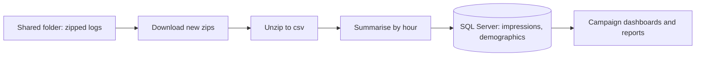

# Screen Data Pipeline: Automating Ad Play and Audience Data into SQL

**How do you turn a stream of zipped log files into clean SQL tables, every day, without manual work?**

| | |
|---|---|
| **Industry** | Retail / Advertising Technology |
| **Role** | Data Analyst |
| **Tools** | Python (pandas, requests, SQLAlchemy, schedule), SQLite, SQL Server, Google Drive API |
| **Deliverables** | Automated pipeline script, setup files |
| **Data & Privacy** | This is a cleaned copy. Credentials, folder IDs, and server names were removed and are read from environment variables. |

---

## 1. The Business Problem

The in-store screen system delivered its logs as **zipped files in a shared folder**: one set for **ad plays** (which creative played, on which screen, in which store, and when) and one for **audience detections** (the gender and age group of viewers by screen and time). Campaign reports and dashboards needed that data in SQL, joined to sales data.

Doing this by hand would be slow and easy to get wrong. The files kept arriving, so the process had to be **automatic, repeatable, and safe to re-run**.

## 2. What the Pipeline Does

1. **Download:** lists the shared folder through the Google Drive API and downloads only zip files that haven't been downloaded before.
2. **Extract:** unzips each archive, deletes the zip, and reports files that are not valid zip archives.
3. **Summarise:** reads each csv and counts rows by hour with SQL (through an in-memory SQLite table), which keeps the data volume manageable while keeping the detail reports need.
4. **Load:** appends the hourly result to the `impressions` or `demographics` table in SQL Server.
5. **Remember:** logs every downloaded zip and every loaded csv, so nothing is loaded twice.
6. **Repeat:** runs once a day on a schedule.

## 3. Tables Created

| Table | One row per | Main fields |
|---|---|---|
| `impressions` | hour, screen, creative, and campaign | campaign, ad group, creative, screen, site, ad type, play duration, row count |
| `demographics` | hour, screen, gender, and age group | site, screen, gender, age group, row count |

## 4. Key Design Choices

- **Incremental, not full reloads:** two simple log files track what has been downloaded and loaded.
- **Aggregate before loading:** hourly counts instead of every raw row.
- **Defensive steps:** empty or malformed files are skipped with a message, and bad zip files are reported.
- **Clean IDs:** numeric IDs that arrived as decimals (for example `123.0`) are converted to integers.

## 5. How to Run It

1. Install the requirements: `pip install -r requirements.txt` (the SQL Server ODBC driver must also be installed).
2. Copy `.env.example` to `.env`, fill in the values, and load them as environment variables.
3. Run `python screen_data_pipeline.py`. It processes everything new, then repeats daily.

## 6. Challenges

- **Files keep arriving.** The pipeline had to recognize which files were already handled, so it keeps download and load logs.
- **Messy data.** IDs stored as decimals, empty rows, and empty or corrupted files had to be handled without stopping the run.
- **Volume.** Summarizing by hour before loading keeps the tables light enough to report on.

## 7. Files

| File | What it is |
|---|---|
| [`screen_data_pipeline.py`](code/screen_data_pipeline.py) | The pipeline script |
| [`requirements.txt`](code/requirements.txt) | Python packages needed |
| [`.env.example`](code/.env.example) | Template for the settings, with no real values |

## 8. What to Know Before Using This

- This is a cleaned copy of a working internal pipeline. It needs access to the source folder and a database to run.
- Table and field names reflect the screen system's log format.
