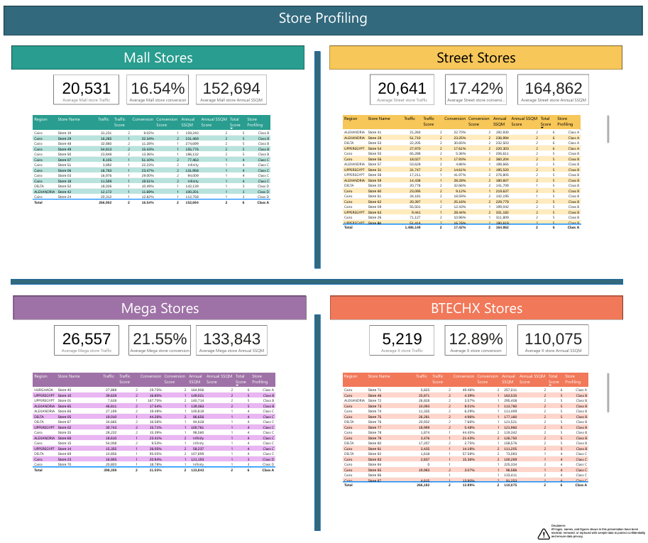
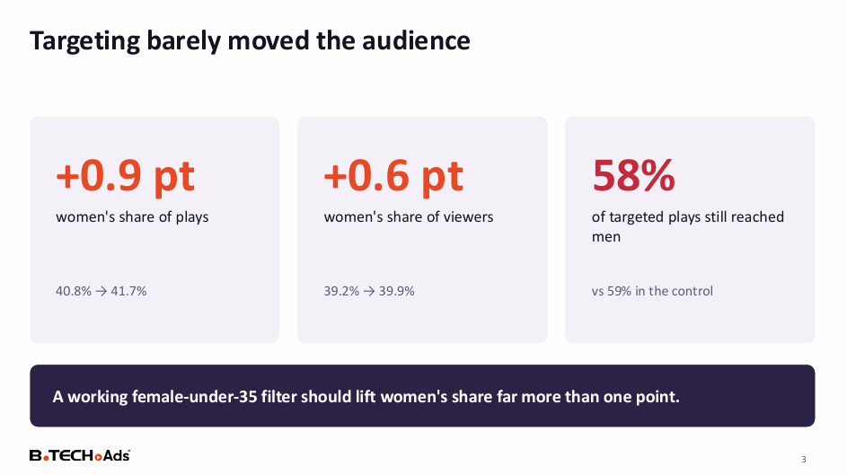

# Store Profiling & Audience Targeting: Scoring Stores and Testing a Targeting Feature

**Which stores are worth the most to advertisers, and did targeting actually change who saw the ads?**

| | |
|---|---|
| **Industry** | Retail / Advertising Technology |
| **Role** | Data Analyst |
| **Tools** | Power BI (DAX, Power Query), SQL, Excel, PowerPoint |
| **Deliverables** | Store profiling dashboard, targeting feature assessment deck |
| **Data & Privacy** | Names and figures are masked or replaced with sample data. The Power BI file is not included. |

---

## 1. The Business Problem

A retailer selling advertising on in-store screens needed two answers:

1. **How do we rank stores?** Stores differ in traffic, conversion, and sales. A fair, simple score would help customize ads for each brand client and support pricing decisions.
2. **Does the new demographic targeting feature work?** The screen system can show an ad only to a chosen audience, such as women under 35. If it works, it could be sold as a premium feature.

## 2. The Short Answer

**Stores can be scored and grouped into four classes. Demographic targeting, however, was not proven to work.**

| Question | Result |
|---|---|
| Store ranking | Each store is scored on traffic, conversion, and annual sales per square meter, then placed in Class A (best) to D |
| Targeting test | Women's share of plays rose only 0.9 points (40.8% to 41.7%) and the share of viewers 0.6 points, where a working filter should move far more |
| Recommendation | Do not present targeting as proven to advertisers until it is traced with the vendor and re-tested at a larger scale |

## 3. Part 1: Store Profiling

**How the score works.** Every store gets a score of 1 or 2 on each of three KPIs: **traffic**, **conversion**, and **annual sales per square meter (SSQM)**. The three scores add up to a total of 3 to 6, which maps to a class: **A (6), B (5), C (4), D (3)**.

**Stores are compared within their own type,** because a mall store and a street store are different businesses. The dashboard covers four types: mall, street, mega, and a small-format "X" type, each with its own average traffic, conversion, and SSQM.

Example of how types differ (sample data): average conversion is about 19% in mall stores, 20% in street stores, 24% in mega stores, and 15% in small-format stores.

**How it is used:** to pick the right stores for each brand's campaign, to price ad space by store class, and to see which stores are weakest and why.

## 4. Part 2: Targeting Feature Assessment

**The test.** Two in-house campaigns ran for 10 days (14-23 August) across 30 stores. One targeted women under 35, and the control had no targeting.

**What we found**
- **Targeting barely moved the audience.** Women were about 40% of viewers in both campaigns, and the age mix stayed the same (about 72-73% under 35).
- **Targeted plays still reached men.** 58% of the targeted campaign's plays went to men, against 59% in the control.
- **Two data sources disagree.** The screen platform reports about 46% women, while in-store analytics saw about 40%, and the platform's own gender view is identical in both campaigns.

**Possible reasons (hypotheses to confirm, not findings)**
1. The filter may not have been live on every screen.
2. The platform may show the plan, not what really happened.
3. The test was small: one campaign pair, 10 days, 30 stores.
4. A filter can only tilt plays when it detects a viewer.

## 5. Recommendations

1. **Hold the claim.** Don't present demographic targeting as proven to advertisers yet.
2. **Trace the rule with the vendor** to confirm the filter was live and how plays are chosen.
3. **Re-test at a bigger scale,** with more stores and days, and agree the success bar up front.
4. **Use one source of truth** by reconciling the platform's demographics with in-store analytics.
5. **For store profiling,** use classes to match brands to stores and to price ad space, and review scores regularly.

## 6. Approach

1. **Profiled stores:** pulled traffic, conversion, and annual sales per square meter for each store, set a score for each KPI within its store type, and combined them into a total and a class.
2. **Built the Power BI dashboard** with Power Query and DAX, with tables by store type and region.
3. **Designed a controlled test** for targeting: same stores, same days, one targeted campaign and one untargeted control.
4. **Compared who played and who watched,** using the screen platform's data and in-store camera analytics (gender and age).
5. **Wrote the assessment deck** with the evidence, open questions, and next steps.

## 7. Challenges

- **Data gaps in the score.** Some stores have missing square-meter data (shown as infinity) and some have conversion rates above 100% or zero traffic. They were scored but need cleaning before the classes are used for decisions.
- **Fair comparison.** Different store types behave differently, so each type is scored on its own averages.
- **A single, small test.** One campaign pair for 10 days cannot prove or disprove targeting, so the deck frames results as open questions.
- **Two sources, two answers.** The platform and the in-store analytics disagreed on gender, so the deck asks which is right instead of picking one.

## 8. Files

| File | What it is |
|---|---|
| [`Store_Profiling_Dashboard.pdf`](reports/Store_Profiling_Dashboard.pdf) | Power BI store profiling dashboard |
| [`Targeting_Assessment_Insights.pdf`](reports/Targeting_Assessment_Insights.pdf) | Targeting feature assessment deck |

## 9. What to Know Before Using This

- All figures are masked or sample data. The project shows the method and the thinking.
- The targeting test is a single small test, so its results are directional.
- Store classes depend on the quality of the underlying traffic and sales data.
