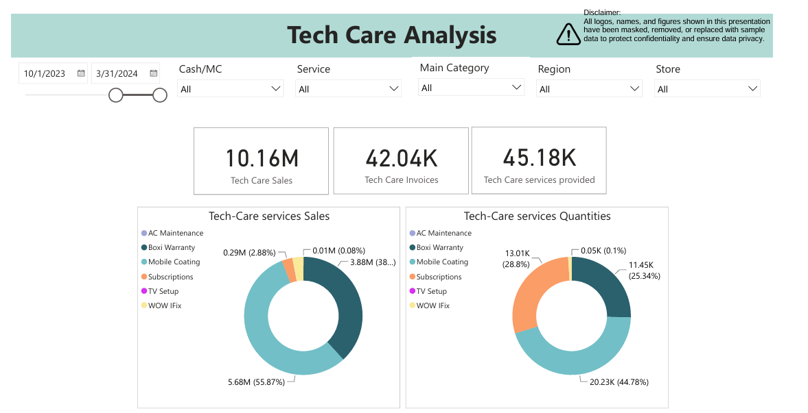

# Tech Care Service Analytics: Measuring a New In-Store Service

**A brand-new service sold in stores: who is selling it, where does it work, and how many shoppers take it?**

| | |
|---|---|
| **Industry** | Retail / Services |
| **Role** | Retail Data Analyst |
| **Tools** | Power BI (DAX, Power Query), SQL |
| **Deliverables** | Service performance dashboard with sales, trends, manager performance, and attachment rates |
| **Data & Privacy** | Logos, names, and figures are masked or replaced with sample data. The Power BI file is not included. |

---

## 1. The Business Problem

An electronics retailer added a new service line to its stores, called **Tech Care**: device repairs, warranty, maintenance, installation, and subscriptions. It was a different kind of business from selling products, with no history and no reporting.

Management and the sales managers needed to answer:
- How much does the service sell, and which services lead?
- Which stores, store formats, and managers are doing well?
- How many customers who buy a product also take a service?

## 2. The Short Answer

**The service sold 10.16M across 42,040 invoices and 45,180 services in six months, but only 4.5% of eligible sales came with a service, and stores that actively sell it reach double that.**

| Signal | What the data shows |
|---|---|
| Size (Oct 2023 to Mar 2024) | 10.16M in sales, 42.04K invoices, 45.18K services provided |
| Attachment rate | 4.54% across all stores, 9.16% in stores that actively sell the service |
| Concentration | Sales are concentrated in a few of the six services, and in a few store formats |
| Managers | Sales vary many times over between the strongest and weakest managers |

## 3. The Dashboard

One long, scrollable page with these sections:

1. **Headline numbers:** sales, invoices, and services provided.
2. **Mix:** sales and quantities by service, by store format, and by sales manager.
3. **Trends:** monthly sales and quantities overall, by service, and by store format.
4. **Attachment rates:** the share of eligible product sales that came with a Tech Care service, trended and split by service, for all stores and for active stores only.
5. **Detail tables:** performance by service, store, manager, and cluster, with the attachment rate for each.

It can be filtered by payment type, service, main product category, region, store, and date.

## 4. How I Defined the Key Metric

**Attachment rate** is the share of product sales that also included a Tech Care service. I calculated it two ways:
- **Total attachment rate:** across all stores.
- **Active stores attachment rate:** only across stores that actually sold the service.

Showing both separates "the service doesn't sell" from "the service isn't offered", which pointed managers to where the opportunity was.

## 5. Key Insights

- **Two numbers, two stories.** The overall attachment rate is 4.54% while active stores reach 9.16%, so the biggest opportunity is getting more stores to sell the service, not only selling more in the stores that do.
- **Concentrated sales.** A few services account for most sales, and one service line makes up the largest share of both sales and quantity.
- **Store format matters.** Format shows very different sales mixes and volumes, so each format needs its own targets.
- **Wide manager spread.** The best managers sell many times more than the weakest, which makes it a coaching opportunity.
- **Trends.** Monthly sales and quantities rise and fall together with product sales, with attachment rates moving more slowly.

## 6. Recommendations

1. **Activate inactive stores:** roughly half of the attachment opportunity sits in stores that don't yet sell the service.
2. **Set attachment targets by service and store format** instead of one company-wide goal.
3. **Coach the weakest managers** using what the strongest do, and fill vacant manager roles.
4. **Bundle services at the point of sale** for the product categories with the highest attachment.

## 7. Approach

1. **Gathered requirements** from the service team and sales managers.
2. **Defined the metrics:** sales, invoices, quantities, services provided, and the two attachment rates.
3. **Built the model** with SQL and Power Query, joining service sales to product sales, stores, formats, and managers.
4. **Wrote the DAX measures** for attachment rates and the trend views.
5. **Designed the dashboard** from headline numbers to store-level detail, and refined it with feedback from managers.

## 8. Challenges

- **A new product with no baseline.** There were no past numbers or definitions, so I defined the metrics from scratch.
- **Linking services to product sales.** The attachment rate needs service sales matched to the product sale they came with.
- **Different store formats.** Each format sells a different mix, so I broke results down by format.

## 9. Files

| File | What it is |
|---|---|
| [`Tech_Care_Dashboard.pdf`](reports/Tech_Care_Dashboard.pdf) | The Power BI dashboard |

## 10. What to Know Before Using This

- All figures are masked or sample data. The project shows the method and the thinking.
- Attachment rates show association with a service, not proof that a service caused product sales.
- The Power BI file and SQL are not included in this repo.
