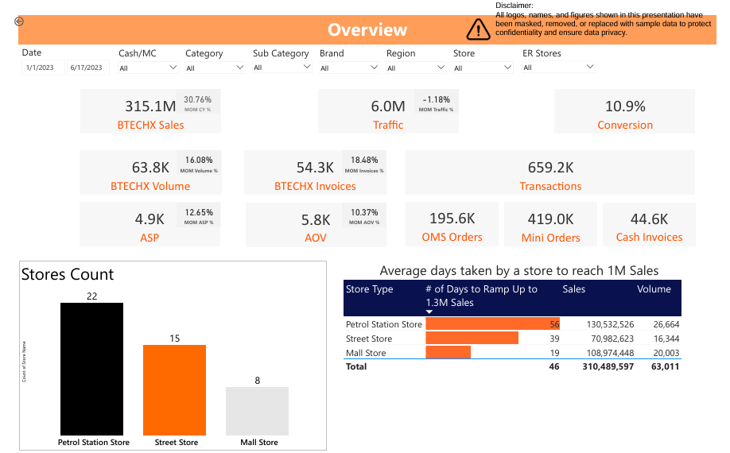
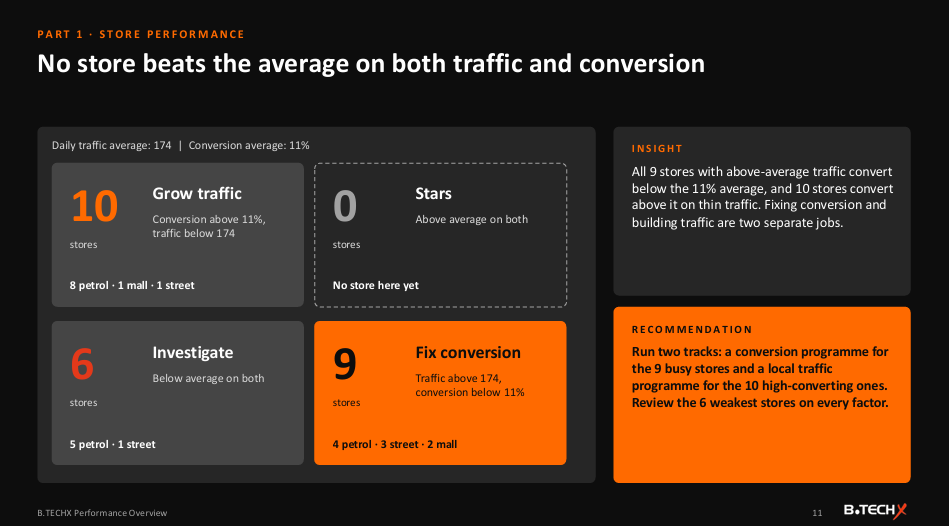
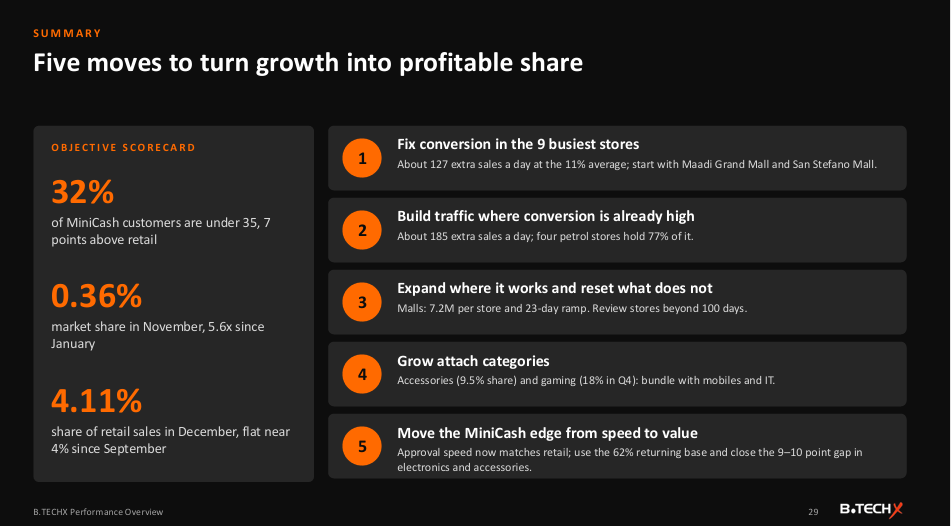

# Youth Store Format Analytics: Dashboard & Executive Performance Review

**A new small store format for young, tech-savvy shoppers: is it growing, who is it reaching, and where should it invest?**

| | |
|---|---|
| **Industry** | Retail (electronics) |
| **Role** | Retail Data Analyst |
| **Tools** | Power BI (DAX, Power Query), SQL, PowerPoint |
| **Deliverables** | 7-page format dashboard, 30-slide performance review for the format manager and an executive vice president |
| **Data & Privacy** | Logos, names, and figures are masked or replaced with sample data. The Power BI file is not included. |

---

## 1. The Business Problem

A large electronics retailer launched a **smaller store format** designed for younger, tech-savvy customers, placed in malls, on streets, and at petrol stations. Management had two objectives:

1. **Attract the younger segment.**
2. **Grow market share in IT and telecom.**

The format manager and an executive vice president needed to know how the stores were performing, what was driving results, and what to do next.

## 2. The Short Answer

**Sales grew with the store count and each store sold more, but the format's share of retail plateaued near 4%, traffic is slipping, and conversion is the lever to pull.**

| Signal | What the data shows |
|---|---|
| Growth | Net sales of 206.8M from stores growing from 4 to 38 (Oct 2021 to Dec 2022); sales per store per month roughly doubled |
| Share of retail | 2.3% since launch, but only about 4% since September, even as stores grew from 34 to 38 |
| Traffic and conversion | The conversion gap to retail narrowed from 11 to 6 points, but daily traffic per store fell 19% |
| Younger customers | 32% of the format's installment-financing customers are under 35, against 25% at retail |
| Market share | IT and telecom share rose 5.6 times in 2022 (0.064% to 0.36%) |

## 3. The Dashboard (7 pages)

1. **Overview:** sales, volume, invoices, traffic, conversion, and order value, store counts, and how many days stores take to reach 1M in sales.
2. **Trends:** sales and volume against the number of stores over time.
3. **Format Contribution:** the format's share of retail sales and volume by category and region.
4. **Cash and Installment Contribution:** sales split between cash and the installment financing program, by category and region.
5. **Traffic and Conversion:** traffic, transactions, and conversion by store.
6. **Assortment:** top products over the last 30 days, with the user choosing the percentage.
7. **Root Cause Analysis:** what drove a change in order value, price, invoices, quantity, sales, or traffic.

It can be filtered by date, payment type, category, brand, region, store, and a flag for stores that need extra attention.

## 4. The Executive Review

A 30-slide deck in three parts, each slide with an insight and a recommendation.

**Part 1: Sales deep dive**
- **Malls sell the most per store** (7.2M), while **petrol stations drive volume** (60% of sales from 22 stores). Mobiles are 56% of sales at petrol and street stores but 43% in malls.
- **Accessories are the standout category** at 9.5% of retail category sales, about 4x the format's overall share.
- **Regions differ:** Cairo contributes 3.0% of retail sales and Delta only 1.8%, and the format has no stores in Upper Egypt.
- **No store beats the average on both traffic and conversion.** Two malls hold 56% of the conversion gap (about 127 extra sales a day at average conversion), and four petrol stations hold 77% of the traffic upside (about 185 extra sales a day).
- **Pricing:** the mobile price premium shrank from +17% to +10%, and IT prices closed in on retail (22% below to 4% below).
- **Installment financing:** its share eased from 67% to 55% as cash sales grew 2.7x, and one-hour approvals rose from 76% to 91% after a policy change.
- **Ramp-up:** malls reach 1M in sales in 23 days, street stores in 52, and petrol stations in 65.

**Part 2: Attracting the younger segment.** Customers skew younger (7 points more under 35), the core customer is 26 to 42, and gaming is a standout: 18% of retail gaming sales in Q4 against 5% in Q1.

**Part 3: IT and telecom market share.** Share rose every month since July. Electronics and mobiles make up 55% of the format's share, while large appliances are almost absent.

## 5. Recommendations

1. **Fix conversion in the nine busiest stores,** starting with the two largest gaps, through product-knowledge training.
2. **Build traffic where conversion is already high,** especially at the four petrol stations.
3. **Expand where it works and reset what does not:** prioritize malls for new openings, budget a longer ramp for petrol sites, and review stores beyond 100 days.
4. **Grow attach categories:** make accessories a standard step on mobile and IT sales, and make gaming the hero category.
5. **Set a quarterly share-of-retail target** (for example 4.5%) and gate new openings on ramp-up.

## 6. Approach

1. **Built the store-format dashboard** with SQL, Power Query, and DAX, including how fast new stores ramp up.
2. **Compared the format with the rest of retail** by category, region, payment type, traffic, and price.
3. **Segmented stores** by traffic and conversion to find where effort pays off, and sized the opportunity in extra sales per day.
4. **Profiled customers** by age and installment-financing behavior.
5. **Wrote the executive review** with a recommendation on every slide and a scorecard against the two objectives.

## 7. Challenges

- **A moving baseline.** The network grew from 4 to 38 stores, so each metric was shown per store as well as in total.
- **Different store types.** Malls, street stores, and petrol stations behave differently, so they were analyzed separately.
- **Sizing the opportunity.** Instead of just ranking stores, I converted gaps into extra sales per day to help managers prioritize.

## 8. Files

| File | What it is |
|---|---|
| [`Youth_Format_Dashboard.pdf`](reports/Youth_Format_Dashboard.pdf) | The 7-page dashboard |
| [`Youth_Format_Performance_Review.pdf`](reports/Youth_Format_Performance_Review.pdf) | Executive performance review |

## 9. What to Know Before Using This

- All figures are masked or sample data. The project shows the method and the thinking.
- The Power BI file and SQL are not included in this repo.
- Customer age findings describe installment-financing customers, not all shoppers.
